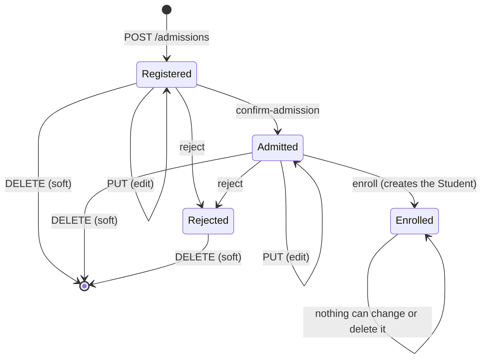
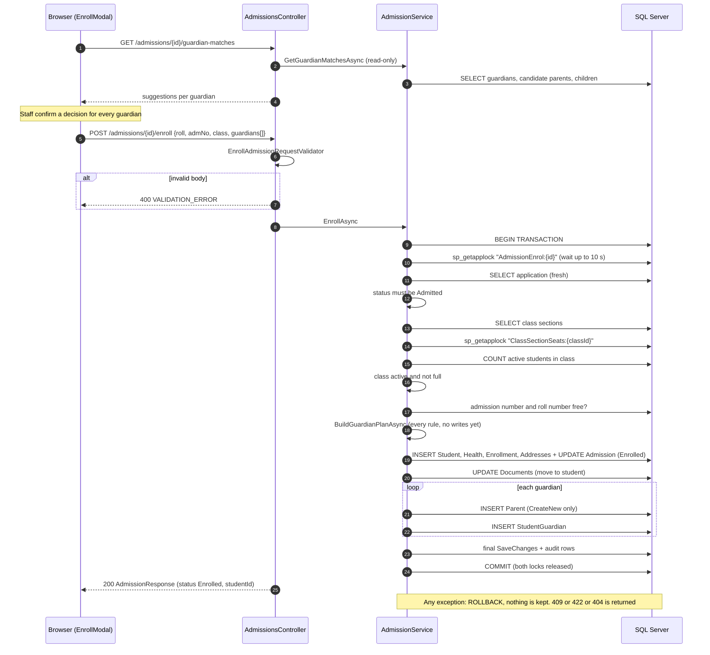

# Admissions controller: what each endpoint actually does

Source: `backend/SchoolManagement.API/Controllers/AdmissionsController.cs`, route prefix `api/admissions`. Service: `Application/Services/AdmissionService.cs`. Repository: `Infrastructure/Repositories/AdmissionRepository.cs`.
Same format as `auth.md`. Written for a developer with about two years of experience who is learning this codebase.

## How this file was made

- **Everything here was read from the code** (controller, service, validators, repository, EF configuration, permission catalog, the React `features/admissions` folder) and cross-checked against the test names in `backend/SchoolManagement.Tests`.
- **I did not run the API or the database** (no SQL Server in my environment). **Every example request and response is invented**: shapes, field names, error codes and messages come from the code; ids, dates, names and trace ids are made up. Nothing here is a captured real response.
- "Tests exist" means a test with that name is in the repo. I did not run them.
- **Not verified** marks anything I could not confirm from the code alone.
- Subsections are lettered after the endpoint number (`4a` to `4h`) so they do not clash with the endpoint numbers.
- Doubts and possible bugs are at the end, labelled **Blocker**, **Should fix** or **Question**.

## The ten endpoints at a glance

| # | Method + URL | Permission (policy) | Called by (React) |
|---|---|---|---|
| 1 | `GET /api/admissions/parent-search` | `Parents.View` **and** (`Admissions.Create` or `Admissions.Edit`) | `ExistingParentPicker.tsx` |
| 2 | `GET /api/admissions` | `Admissions.View` | `AdmissionsPage.tsx` |
| 3 | `GET /api/admissions/{id}` | `Admissions.View` | `AdmissionDetailPage.tsx`, `AdmissionFormPage.tsx` |
| 4 | `POST /api/admissions` | `Admissions.Create` | `AdmissionFormPage.tsx` |
| 5 | `PUT /api/admissions/{id}` | `Admissions.Edit` | `AdmissionFormPage.tsx` |
| 6 | `POST /api/admissions/{id}/confirm-admission` | `Admissions.Edit` | `AdmissionDetailPage.tsx` |
| 7 | `GET /api/admissions/{id}/guardian-matches` | `Admissions.Edit` | `EnrollModal.tsx` |
| 8 | `POST /api/admissions/{id}/enroll` | `Admissions.Enroll` | `AdmissionDetailPage.tsx` (`EnrollModal`) |
| 9 | `POST /api/admissions/{id}/reject` | `Admissions.Edit` | `AdmissionDetailPage.tsx` |
| 10 | `DELETE /api/admissions/{id}` | `Admissions.Delete` | `AdmissionsPage.tsx`, `AdmissionDetailPage.tsx` |

## Background you need before the endpoints

### An application moves through four statuses



Constants: `AdmissionStatuses` in `Domain/Entities/StatusVocabularies.cs`; the database check constraint `CK_Admissions_Status` is generated from the same list. **Rejected is terminal** (no endpoint reopens it). **Enrolled is permanent**: it cannot be edited, rejected or deleted.

### The same request pipeline as Auth

Correlation id → Serilog → `GlobalExceptionMiddleware` → HTTPS → CORS → JWT (with the security-stamp check) → `MustChangePasswordMiddleware` → authorization → controller. See `auth.md`, "The request pipeline". Every Admissions endpoint needs a signed-in user and a permission (the `[Authorize(Policy = ...)]` attribute on the action). The policy provider turns a permission name into a policy automatically (`PermissionPolicyProvider`).

Permission dependencies (`Domain/Constants/PermissionDependencies.cs`): the catalog declares that `Admissions.Create`, `.Edit` and `.Enroll` go together with `Admissions.View` and `ClassSections.View`. How the Roles screen enforces that is covered in the Roles file. Note that `Edit` is **not** a dependency of `Enroll` (doubt 2).

### The response everyone gets: `AdmissionResponse`

Used by endpoints 2 to 6, 8 and 9 (`Application/DTOs/Admissions/AdmissionResponse.cs`).

| Field | Type | Meaning |
|---|---|---|
| `id` | int | |
| `regNo` | string | `REG-<year>-<id padded to 4>`, for example `REG-2026-0007` |
| `firstName`, `middleName?`, `lastName` | string | |
| `gender` | string | Free text up to 10 characters (see doubt 13) |
| `dateOfBirth` | date | |
| `academicYearName` | string | Taken from the applied-for class section |
| `appliedForClassSectionId`, `appliedForClassSectionName` | int, string | |
| `admissionType` | string | `New` or `Transfer` |
| `previousSchool?` | string | |
| `phone` | string | The applicant's contact number |
| `email?` | string | |
| `registrationDate` | date | UTC date the application was created |
| `status` | string | `Registered`, `Admitted`, `Enrolled`, `Rejected` |
| `rejectionReason?` | string | Only for `Rejected` |
| `addresses` | array | `{id, addressType, isPrimary, line1, line2?, city, countryId, countryName, regionId?, regionName?, postalCode?}` |
| `admissionFee?`, `admissionFeeReference?` | decimal, string | Filled by confirm-admission |
| `bloodGroup?`, `religion?`, `category?`, `medicalNotes?`, `remarks?` | string | `religion`, `category`, `medicalNotes`, `bloodGroup` are filled by confirm-admission |
| `rollNumber?`, `admissionNumber?`, `admissionDate?`, `entryPoint?`, `transportRequired` | | Filled by enroll |
| `allottedClassSectionId?`, `allottedClassSectionName?` | | Filled by enroll |
| `studentId?` | int | The student created by enroll |
| `guardians` | array | `{id, relationType, name, mobile?, email?, isPrimaryContact, parentId?}` |
| `rowVersion` | string | Base64 of the 8-byte SQL Server `rowversion`; send it back unchanged on `PUT` |

**How the response differs by user: it does not.** There is no data scope on Admissions and no field is hidden for anyone who may read it. Religion, category, medical notes and fee are visible to every holder of `Admissions.View`. That is why the seeded Teacher role deliberately has no `Admissions.View` (comment in the E1 migration and `ExpectedRoleMatrix`). Among the six seeded roles only Admin has any write permission on admissions (Supervisor and Clerk hold `Admissions.View` only).

### Audit and transactions on this controller

- `AuditableEntitySaveChangesInterceptor` stamps `CreatedBy/UpdatedBy` and writes `AuditLogs` rows for `Admission`, `AdmissionGuardian`, `Address`, `Student`, `Parent`, `StudentGuardian`, `Document` and others (see `auth.md`). Reads are **not** audited on this controller.
- `AdmissionRepository.ExecuteInTransactionAsync` runs a block in one database transaction with the EF execution strategy. It also turns a SQL Server unique-index violation (error 2601 or 2627) into **409 `CONFLICT`** with the message "This record conflicts with one just saved by someone else (for example the same admission number or roll number). Reload and try again."
- `DbUpdateConcurrencyException` (a stale row version) becomes **409 `CONCURRENCY_CONFLICT`** in `GlobalExceptionMiddleware`.
- Row version: `Admission.RowVersion` is a real SQL Server `rowversion` (`IsRowVersion()` in `AdmissionConfiguration`). **Only `PUT` demands it from the client.** The other changes (confirm, enroll, reject, delete) are protected by the status check, and by EF's own check of the version it loaded.

---

## 1. `GET /api/admissions/parent-search`

### 1a. Purpose and caller

Typeahead on the registration form: "Find an existing parent". Lets staff attach an already-registered parent to a new application instead of typing the person again (G2).
Called by `ExistingParentPicker.tsx` → `admissionService.searchParents(text)` → `apiClient.get("/admissions/parent-search", {params: {q}})`. It sits on `AdmissionFormPage.tsx` and only appears if the user holds `Parents.View`.

### 1b. Request

Query string; no body. No validator class; the rules live in the service.

| Parameter | Type | Required | Rules |
|---|---|---|---|
| `q` | string | no | Trimmed. A name search needs **at least 2 characters**. A mobile search uses the digits found in `q` and needs **at least 3 digits**. If neither condition holds the answer is an empty list |
| `take` | int | no | 0 or missing means 8; then clamped to 1 to 10 |

### 1c. Response

`200 OK`, array of `ParentCandidateResponse` (`parentId`, `name`, `mobile`, `email?`, `linkedChildren` = array of "First Last" strings of the students the parent is linked to), ordered by name then id.
Differences by user: none among the people who can call it. Everyone who passes the check sees mobile numbers, e-mails and children's names. A user who only holds `Parents.ViewScoped` (the Teacher role) is refused (test: `Search_is_refused_without_Parents_View_even_for_a_user_who_can_see_scoped_parents`).

### 1d. Logic, in order

| # | Step | File and method |
|---|---|---|
| 1 | Policy `Parents.View` (full view, not scoped) | `[Authorize(Policy = Permissions.ParentsView)]` on `SearchParents` |
| 2 | Second check **inside the action**: needs `Admissions.Create` **or** `Admissions.Edit`, else `ForbiddenException` → 403 | `AdmissionsController.SearchParents` (uses `ICurrentUserPermissions`, which reads the permission cache) |
| 3 | Work out `nameText` and `digitText`, clamp `take` | `AdmissionService.SearchParentsAsync` |
| 4 | `SELECT TOP(take) ... FROM Parents WHERE Name LIKE %text% OR MobileKey LIKE %digits% ORDER BY Name, Id`, no tracking. EF escapes `%` and `_`. Deleted parents are hidden by the query filter | `AdmissionRepository.SearchParentsAsync` |
| 5 | If rows were found: one more query for the linked children (`StudentGuardians` joined to `Students`) | `AdmissionRepository.GetLinkedChildrenAsync` |
| 6 | Group the children by parent and build the response | `SearchParentsAsync` |

Transaction, locks, audit rows, cache and session effects: none. Read-only.

### 1e. Business rules and where each is enforced

| Rule | Enforced in |
|---|---|
| Needs full `Parents.View` | Controller attribute (policy) |
| Needs the right to register or edit applications | Controller, inside the action (not in the attribute; see doubt 8) |
| A single keystroke cannot list everybody (min 2 letters or 3 digits) | Service |
| At most 10 rows | Service (`Math.Clamp`) |
| Deleted parents never appear | EF global query filter on `Parents` (test: `Search_never_returns_a_deleted_parent`) |

### 1f. Errors

| Status | `errorCode` | Condition |
|---|---|---|
| 401 | `UNAUTHENTICATED` | No/invalid/expired token |
| 403 | `PASSWORD_CHANGE_REQUIRED` | The user must change their password first |
| 403 | `FORBIDDEN` | Missing `Parents.View` (message "You do not have permission to perform this action.") |
| 403 | `FORBIDDEN` | Has `Parents.View` but neither `Admissions.Create` nor `Admissions.Edit` (message "Searching parents needs permission to register or edit applications.") |
| 400 | not our envelope | `take` that is not an integer: ASP.NET's automatic model-binding error. **Not verified** |
| 500 | `INTERNAL_SERVER_ERROR` | Unhandled exception |

### 1g. Concurrency and retries

Read-only; safe to repeat. No row version.

### 1h. Why is it built this way?

**Decision:** a dedicated, deliberately narrow search endpoint with two permission checks and minimum search lengths.
**Alternative:** let the registration form call the general parents list and filter in the browser.
**Trade-off:** the general list would expose every parent's phone number to anyone who can register an application. The narrow endpoint limits what one request can reveal, at the cost of a second code path that has to be kept in line with the Parents module (the `DataScopeTests` guard test has an explicit exception for it, `PlainViewExceptions`).

### Example (invented)

```http
GET /api/admissions/parent-search?q=rahman&take=5
Authorization: Bearer eyJ...invented...
```
```http
HTTP/1.1 200 OK

[
  { "parentId": 12, "name": "Abdul Rahman", "mobile": "+971501234567",
    "email": "a.rahman@example.com", "linkedChildren": ["Sara Rahman"] }
]
```

Tests that exist: the first five tests of `AdmissionExistingParentTests` (search results, refused without `Parents.View`, refused without Create/Edit, minimum lengths, deleted parents); `AccessMatrixTests` row for `/api/admissions/parent-search`.

---

## 2. `GET /api/admissions`

### 2a. Purpose and caller

List all applications for the Admissions pipeline page.
Called by `AdmissionsPage.tsx` → `admissionService.getAll()`. The page filters by status and text **in the browser**.

### 2b. Request

No parameters, no body, no validator. Requires `Admissions.View`.

### 2c. Response

`200 OK`, an array of `AdmissionResponse` (defined above), **every non-deleted application**, newest first (`ORDER BY Id DESC`), each with its guardians and addresses. No paging, filtering or sorting options. Same for every user.

### 2d. Logic, in order

| # | Step | File and method |
|---|---|---|
| 1 | Policy `Admissions.View` | `[Authorize(Policy = Permissions.AdmissionsView)]` |
| 2 | Load everything | `AdmissionService.GetAllAsync` → `AdmissionRepository.GetAllAsync` |
| 3 | The query includes `AcademicYear`, `AppliedForClassSection`, `AllottedClassSection`, `Student`, `Guardians`, `Addresses` with `Country` and `Region`, as a **split query** (several SELECTs instead of one huge join) | `AdmissionRepository.WithIncludes` |
| 4 | Map each row to `AdmissionResponse` | `AdmissionService.ToResponse` |

The entities are tracked (no `AsNoTracking`). Transaction, locks, audit rows: none.

### 2e. Business rules and where each is enforced

| Rule | Enforced in |
|---|---|
| Soft-deleted applications are hidden | EF global query filter `!a.IsDeleted` in `AdmissionConfiguration`; guardians have the matching filter `!g.Admission.IsDeleted` |

### 2f. Errors

| Status | `errorCode` | Condition |
|---|---|---|
| 401 | `UNAUTHENTICATED` | No/invalid token |
| 403 | `PASSWORD_CHANGE_REQUIRED` / `FORBIDDEN` | Password change pending / no `Admissions.View` |
| 500 | `INTERNAL_SERVER_ERROR` | Unhandled exception |

### 2g. Concurrency and retries

Read-only; safe to repeat.

### 2h. Why is it built this way?

**Decision:** return everything and let the browser filter.
**Alternative:** server-side paging and status/year filters.
**Trade-off:** simple, and fast enough while there are hundreds of applications; but the response, the memory and the seven-query split load all grow with the total number of applications ever created, which never shrinks (deleted ones are only hidden). The index `IX_Admissions_AcademicYearId_Status` exists for the filter the API does not yet offer (doubt 5).

### Example (invented)

```http
GET /api/admissions
Authorization: Bearer eyJ...invented...
```
```http
HTTP/1.1 200 OK

[
  { "id": 7, "regNo": "REG-2026-0007", "firstName": "Sara", "middleName": null, "lastName": "Rahman",
    "gender": "Female", "dateOfBirth": "2018-04-02", "academicYearName": "2026-2027",
    "appliedForClassSectionId": 3, "appliedForClassSectionName": "Grade 1 - A (2026-2027)",
    "admissionType": "New", "previousSchool": null, "phone": "+971501234567", "email": null,
    "registrationDate": "2026-10-14", "status": "Registered", "rejectionReason": null,
    "addresses": [], "admissionFee": null, "admissionFeeReference": null, "bloodGroup": null,
    "religion": null, "category": null, "medicalNotes": null, "remarks": null,
    "rollNumber": null, "admissionNumber": null, "admissionDate": null, "entryPoint": null,
    "transportRequired": false, "allottedClassSectionId": null, "allottedClassSectionName": null,
    "studentId": null, "guardians": [], "rowVersion": "AAAAAAAAB9E=" }
]
```

---

## 3. `GET /api/admissions/{id}`

### 3a. Purpose and caller

Open one application (detail page, edit form).
Called by `AdmissionDetailPage.tsx` and `AdmissionFormPage.tsx` (edit mode) → `admissionService.getById(id)`. The edit form keeps the returned `rowVersion` and sends it back on save.

### 3b. Request

Route `{id:int}`. No body, no validator. Requires `Admissions.View`. A non-integer id does not match the route (ASP.NET answers 404; **Not verified**).

### 3c. Response

`200 OK`, one `AdmissionResponse`. Same for every user.

### 3d. Logic, in order

| # | Step | File and method |
|---|---|---|
| 1 | Policy `Admissions.View` | controller attribute |
| 2 | Load with the same includes as the list, `FirstOrDefault(a => a.Id == id)` | `AdmissionService.GetOrThrowAsync` → `AdmissionRepository.GetByIdAsync` |
| 3 | Not found → `NotFoundException("Admission {id} does not exist.")` | `GetOrThrowAsync` |
| 4 | Map | `ToResponse` |

### 3e. Business rules and where each is enforced

Same as endpoint 2: a soft-deleted application behaves as if it did not exist (query filter).

### 3f. Errors

| Status | `errorCode` | Condition |
|---|---|---|
| 401 / 403 | `UNAUTHENTICATED` / `PASSWORD_CHANGE_REQUIRED` / `FORBIDDEN` | As endpoint 2 |
| 404 | `NOT_FOUND` | No such id, or soft-deleted ("Admission 99 does not exist.") |
| 500 | `INTERNAL_SERVER_ERROR` | Unhandled exception |

### 3g. Concurrency and retries

Read-only; safe to repeat. The `rowVersion` you get is the value to send on `PUT`.

### 3h. Why is it built this way?

**Decision:** the response embeds guardians, addresses and the class names, so one call fills the detail page.
**Alternative:** separate endpoints for guardians and addresses.
**Trade-off:** fewer round trips and one consistent `rowVersion`; but every read pays for the joins even when only the status is needed.

### Example (invented)

```http
GET /api/admissions/99
Authorization: Bearer eyJ...invented...
```
```http
HTTP/1.1 404 Not Found

{ "success": false, "message": "Admission 99 does not exist.", "errorCode": "NOT_FOUND",
  "traceId": "7a1d0000-0000-0000-0000-invented00005" }
```

---

## 4. `POST /api/admissions`

### 4a. Purpose and caller

Register a new application. It starts as `Registered`.
Called by `AdmissionFormPage.tsx` → `admissionService.create(request)` (new-application mode). The form also uploads documents after the application exists (that is the Documents controller, covered later).

### 4b. Request

JSON body `CreateAdmissionRequest` (`Application/DTOs/Admissions/CreateAdmissionRequest.cs`). Validators: `Application/Validators/CreateAdmissionRequestValidator.cs` (class `CreateAdmissionRequestValidatorBase`), `AdmissionGuardianRequestValidator.cs`, `AddressRequestValidator.cs`.

| Field | Type | Required | Rules |
|---|---|---|---|
| `firstName` | string | yes | Not empty, max 50 |
| `middleName` | string | no | Column max 50; **not checked by the validator** (doubt 3) |
| `lastName` | string | yes | Not empty, max 50 |
| `gender` | string | yes | Not empty. No list of allowed values; the column is 10 characters |
| `dateOfBirth` | date | yes | Earlier than today's **UTC** date. No minimum |
| `appliedForClassSectionId` | int | yes | Greater than 0; must exist and be active (service) |
| `admissionType` | string | yes | `New` or `Transfer` (`AdmissionTypes.IsValid`) |
| `previousSchool` | string | no | Column max 100; **not checked by the validator** (doubt 3) |
| `phone` | string | yes | Not empty, max 20. **No format check** (guardian mobiles do have one) |
| `email` | string | no | Valid e-mail if not empty; column max 100 |
| `addresses` | array | no | Each: `addressType` (Home, Permanent or Mailing), `isPrimary`, `line1` (required, max 200), `line2` (max 200), `city` (required, max 60), `countryId` (> 0), `regionId?`, `postalCode?` (max 12). List rules: one address per type, exactly one primary if the list is not empty. Country rules (region required, postcode pattern) are checked by `AddressService` |
| `remarks` | string | no | Max 300 |
| `guardians` | array | no | At most 5; at most one `isPrimaryContact`; at most one `Father` and one `Mother`. Each guardian: `relationType` (`Father`, `Mother` or `Guardian`), `parentId?` (> 0). If `parentId` is **empty**: `name` required, max 100; `mobile` optional but if given must match `^\+?[0-9\s\-().]{5,20}$`; `email` optional, valid, max 100. If `parentId` is **set**: the server copies name, mobile and e-mail from that parent and ignores what the form sent |

### 4c. Response

`201 Created`, body `AdmissionResponse` for the new application (`status: "Registered"`, `regNo` set, `rowVersion` set). Header `Location: api/admissions/{id}` (relative, no leading slash; see doubt 12). Same for every user.

### 4d. Logic, in order

| # | Step | File and method |
|---|---|---|
| 1 | Policy `Admissions.Create` | controller attribute |
| 2 | Validate the body; on failure the **controller** builds the 400 envelope | `AdmissionsController.ValidateAsync`, the three validators |
| 3 | Does the caller hold `Parents.View`? (decides if existing parents may be linked) | `AdmissionsController.CanLinkParentsAsync` |
| 4 | Load the class section: `GetClassSectionOrThrowAsync` calls `ClassSectionRepository.GetAllAsync()` and picks the id in memory. Missing → `NotFoundException("Class section {id} does not exist.")` | `AdmissionService.GetClassSectionOrThrowAsync` |
| 5 | Class must be `Active` | `ClassSectionRules.EnsureActive` |
| 6 | Build addresses: country must exist, region/postcode rules per country. All problems are collected and thrown together as `RequestValidationException` with keys like `Addresses[0].RegionId` | `AddressService.BuildAsync` |
| 7 | Build guardians: same parent twice → `BusinessRuleException`; new link without `Parents.View` → `ForbiddenException`; unknown or deleted parent → `NotFoundException` | `AdmissionService.MapGuardiansAsync` |
| 8 | **Transaction** starts | `AdmissionRepository.ExecuteInTransactionAsync` |
| 9 | New `Admission`: `Status = "Registered"`, `RegistrationDate` = UTC today, `AcademicYearId` = the **class section's** year (not caller-supplied), `RegNo = "PENDING"` | `AdmissionService.CreateAsync` |
| 10 | `INSERT` admission + guardians + addresses (first `SaveChanges`); the identity column gives the id | `AdmissionRepository.AddAsync` |
| 11 | `RegNo = "REG-" + UtcNow.Year + "-" + Id:D4`; second `SaveChanges` (`UPDATE`) | `CreateAsync` |
| 12 | Commit; map to the response | `ToResponse` |

Database work: one `SELECT` for all class sections, reads of countries and of any linked parents, then `INSERT`s into `Admissions`, `AdmissionGuardians`, `Addresses`, and one `UPDATE Admissions`.
Locks: none explicit. (The unique index on `RegNo` makes a second concurrent registration wait on the `PENDING` key until the first transaction commits; this is an inference, **Not verified**.)
Audit rows: `Insert` rows for the admission, each guardian and each address, and an `Update` row for the `RegNo` change; all in the same transaction (the interceptor uses the transaction that is already open).
Cache and session effects: none.

### 4e. Business rules and where each is enforced

| Rule | Enforced in |
|---|---|
| Required fields, lengths, e-mail, admission type, DOB in the past | Validator |
| Guardian list limits (5, one primary, one father, one mother) | Validator; the database also enforces one primary per application (`UX_AdmissionGuardians_Admission_Primary`) |
| Relation type is Father, Mother or Guardian | Validator; database check `CK_AdmissionGuardians_RelationType` |
| Applied-for class must exist | Service (404) |
| Inactive class cannot take applications | Service (`ClassSectionRules.EnsureActive`) |
| Academic year comes from the class | Service (`AcademicYearId = classSection.AcademicYearId`) |
| New applications are `Registered` | Service; database check `CK_Admissions_Status` |
| Same existing parent cannot be added twice | Service (422); database unique index `UX_AdmissionGuardians_Admission_Parent` |
| Choosing an existing parent needs `Parents.View` | Service (403), decided by the controller's `canLinkParents` flag |
| Guardian mobile is optional now, required at enrolment | Validator comment + `BuildGuardianPlanAsync` (see endpoint 8) |
| One address per type, one primary | Validator; database enforces the same two |
| `RegNo` unique | Database unique index on `Admissions.RegNo` |

### 4f. Errors

| Status | `errorCode` | Condition |
|---|---|---|
| 400 | `VALIDATION_ERROR` | Any validator rule, or an address country/region/postcode rule (keys like `Addresses[0].PostalCode`) |
| 401 / 403 | `UNAUTHENTICATED` / `PASSWORD_CHANGE_REQUIRED` / `FORBIDDEN` | No token / password change pending / no `Admissions.Create` |
| 403 | `FORBIDDEN` | Guardian names a `parentId` but the caller lacks `Parents.View` ("Choosing an existing parent needs permission to view parents.") |
| 404 | `NOT_FOUND` | Class section does not exist; or a `parentId` does not exist or was deleted |
| 409 | `CONFLICT` | The class section is inactive; or a unique-index violation inside the transaction |
| 422 | `BUSINESS_RULE_VIOLATION` | "The same parent cannot be added twice to one application." |
| 500 | `INTERNAL_SERVER_ERROR` | Unhandled exception |

### 4g. Concurrency and retries

- No row version applies to a create.
- **Not idempotent.** Repeating the call creates a second application; there is no duplicate check on name, date of birth or phone (doubt 11). A client that did not receive the 201 should look in the list before retrying.

### 4h. Why is it built this way?

**Decision:** the academic year of an application is derived from the class section it applies to.
**Alternative:** the form sends both a year and a class.
**Trade-off:** the derived year can never disagree with the class (a class already belongs to exactly one year), and there is one fewer field to validate. The price is that the year cannot be set independently, so if the school ever needs to take applications for a year before its classes exist, that rule has to be revisited.

### Example (invented)

```http
POST /api/admissions
Authorization: Bearer eyJ...invented...
Content-Type: application/json

{
  "firstName": "Sara", "middleName": null, "lastName": "Rahman",
  "gender": "Female", "dateOfBirth": "2018-04-02",
  "appliedForClassSectionId": 3, "admissionType": "New", "previousSchool": null,
  "phone": "+971501234567", "email": null,
  "addresses": [
    { "addressType": "Home", "isPrimary": true, "line1": "Villa 12, Street 4",
      "line2": null, "city": "Abu Dhabi", "countryId": 1, "regionId": 2, "postalCode": null }
  ],
  "remarks": null,
  "guardians": [
    { "relationType": "Father", "name": "Abdul Rahman", "mobile": "+971501234567",
      "email": null, "isPrimaryContact": true, "parentId": null }
  ]
}
```
```http
HTTP/1.1 201 Created
Location: api/admissions/7

{ "id": 7, "regNo": "REG-2026-0007", "status": "Registered", "academicYearName": "2026-2027",
  "...": "(the other AdmissionResponse fields, as in endpoint 2)", "rowVersion": "AAAAAAAAB9E=" }
```
```http
HTTP/1.1 409 Conflict

{ "success": false, "message": "'Grade 1 - A (2026-2027)' is inactive and cannot accept new admissions or students.",
  "errorCode": "CONFLICT", "traceId": "7a1d0000-0000-0000-0000-invented00006" }
```

Tests that exist: `AdmissionExistingParentTests` (linking copies the parent's details and ignores the form values; unknown parent 404 and nothing created; deleted parent cannot be linked; same parent twice 422; linking without `Parents.View` 403 and nothing created; keeping an existing link without the permission). `AccessMatrixTests` row. No test of the validator or of `RegNo` generation was found. **Not verified.**

---

## 5. `PUT /api/admissions/{id}`

### 5a. Purpose and caller

Edit the registration-stage data of an application that is still in progress (`Registered` or `Admitted`): applicant details, class, addresses and the guardian list.
Called by `AdmissionFormPage.tsx` (edit mode) → `admissionService.update(id, request)`, with the `rowVersion` from the `GET` that loaded the form.

### 5b. Request

JSON body `UpdateAdmissionRequest`: every field of the create request, plus `rowVersion`. Validator: `Application/Validators/UpdateAdmissionRequestValidator.cs` (the rules are the same as create, written out again in that file), `AdmissionGuardianRequestValidator.cs`, `AddressRequestValidator.cs`.

| Field | Type | Required | Rules |
|---|---|---|---|
| `rowVersion` | string | yes | Valid base64 that decodes to exactly 8 bytes (`RowVersionRules.IsValid`) |
| all other fields | | | As endpoint 4. `middleName` and `previousSchool` are again not length-checked (doubt 3) |
| `addresses` | array or `null` | no | **`null` means "leave the stored addresses alone"**; a list replaces them |
| `guardians` | array or `null` | no | **`null` is treated as an empty list and removes every guardian** (doubt 1) |

Not editable here (by design): `status`, fee, blood group, religion, category, medical notes, roll number, admission number and everything else filled at later stages. The comment in the code calls this "the verified business rule from the prototype".

### 5c. Response

`200 OK`, `AdmissionResponse` with the **new** `rowVersion`. Same for every user.

### 5d. Logic, in order

| # | Step | File and method |
|---|---|---|
| 1 | Policy `Admissions.Edit` | controller attribute |
| 2 | Validate the body (400 envelope from the controller) | `UpdateAdmissionRequestValidator` |
| 3 | Does the caller hold `Parents.View`? | `CanLinkParentsAsync` |
| 4 | Load the application with includes; not found → 404 | `AdmissionService.GetOrThrowAsync` |
| 5 | Only `Registered` or `Admitted` may be edited, else `ConflictException` (different message for Enrolled and for Rejected) | `RequireEditable` |
| 6 | Tell EF which version the client saw: sets the `RowVersion` original value and forces the row into the `UPDATE`. A stale value fails later, at the first `SaveChanges` | `ConcurrencyGuard.Expect` (`Infrastructure/Persistence/ConcurrencyGuard.cs`) |
| 7 | Load the new class section; only a **changed** class must be `Active` | `GetClassSectionOrThrowAsync`, `ClassSectionRules.EnsureActive` |
| 8 | Build the new addresses (only if `addresses` is not null) | `AddressService.BuildAsync` |
| 9 | Remember which parents are already linked (they stay linkable without `Parents.View`), then build the new guardians | `MapGuardiansAsync` |
| 10 | **Transaction**: if the application had guardians, `Guardians.Clear()` and `SaveChanges` first, so the "one primary contact" unique index never sees old and new rows together. This first save is where a stale `rowVersion` is detected (when there were no guardians, it is detected at the last save) | `AdmissionService.UpdateAsync` |
| 11 | Add the new guardians; replace the addresses (`AddressService.ReplaceAsync`: remove types that are gone, then add and update) | same |
| 12 | Copy the registration fields onto the entity; `AcademicYearId` is re-derived from the (possibly new) class; `SaveChanges`; commit | same |

Locks: none explicit. Optimistic concurrency only.
Audit rows: `Update` on `Admissions` with the changed fields; `Delete` and `Insert` rows for every guardian (the set is replaced, so each edit gives the guardians new ids); address inserts, updates and deletes.
Cache and session effects: none.

### 5e. Business rules and where each is enforced

| Rule | Enforced in |
|---|---|
| Only in-progress applications can be edited | Service (`RequireEditable`); lifecycle test `Editing_a_closed_application_is_refused_and_changes_nothing` |
| Edits are refused if someone else saved first | Service/EF: `ConcurrencyGuard` + SQL Server `rowversion` |
| A deactivated class is accepted only if the application was already in it | Service (compares the old and new class ids) |
| The year follows the class | Service |
| Guardian and address list rules | Validator, plus the database unique indexes |
| Choosing a NEW existing parent needs `Parents.View`; keeping a link the application already has does not | Service (`alreadyLinked` set), test `A_user_without_Parents_View_can_keep_an_existing_link_but_cannot_add_a_new_one` |

### 5f. Errors

| Status | `errorCode` | Condition |
|---|---|---|
| 400 | `VALIDATION_ERROR` | Any validator rule (including a missing or malformed `rowVersion`), or an address country rule |
| 401 / 403 | `UNAUTHENTICATED` / `PASSWORD_CHANGE_REQUIRED` / `FORBIDDEN` | As before; `FORBIDDEN` also for a new parent link without `Parents.View` |
| 404 | `NOT_FOUND` | Application, class section or a `parentId` does not exist |
| 409 | `CONFLICT` | The application is `Enrolled` or `Rejected`; a **changed** class is inactive; a unique-index violation |
| 409 | `CONCURRENCY_CONFLICT` | `rowVersion` is not the current one ("This record was changed by someone else after you opened it...") |
| 422 | `BUSINESS_RULE_VIOLATION` | The same parent twice in the guardian list |
| 500 | `INTERNAL_SERVER_ERROR` | Unhandled exception, including a text value longer than its column (doubt 3) |

Order matters: a closed application with a stale `rowVersion` returns the `CONFLICT` "closed" message, not `CONCURRENCY_CONFLICT`, because step 5 runs before step 6.

### 5g. Concurrency and retries

- `rowVersion` is required. Two people editing the same application: the second save gets 409 `CONCURRENCY_CONFLICT`; the transaction rolls back, nothing is half-saved.
- **Repeating a successful call fails** with 409 `CONCURRENCY_CONFLICT`, because the first call changed the version. This is a safe failure. To retry after a lost response, reload first.
- Guardian ids from any earlier `guardian-matches` response are no longer valid after an edit (doubt 10).

### 5h. Why is it built this way?

**Decision:** replace the guardians (and, when sent, the addresses) as a set instead of diffing them.
**Alternative:** update rows in place by id.
**Trade-off:** set replacement is simple and cannot leave an inconsistent list, and the form never has to track ids. The cost is churn in `AdmissionGuardians` and `AuditLogs` (each edit deletes and inserts every guardian), a two-step save to avoid tripping the unique index, and the `null` ambiguity noted in doubt 1.

### Example (invented)

```http
PUT /api/admissions/7
Authorization: Bearer eyJ...invented...
Content-Type: application/json

{ "firstName": "Sara", "middleName": null, "lastName": "Rahman", "gender": "Female",
  "dateOfBirth": "2018-04-02", "appliedForClassSectionId": 3, "admissionType": "New",
  "previousSchool": null, "phone": "+971501234567", "email": "family@example.com",
  "addresses": null, "remarks": "Sibling in Grade 4",
  "guardians": [ { "relationType": "Father", "name": "Abdul Rahman", "mobile": "+971501234567",
                   "email": null, "isPrimaryContact": true, "parentId": null } ],
  "rowVersion": "AAAAAAAAB9E=" }
```
```http
HTTP/1.1 409 Conflict

{ "success": false,
  "message": "This record was changed by someone else after you opened it. Reload it and make your changes again.",
  "errorCode": "CONCURRENCY_CONFLICT", "traceId": "7a1d0000-0000-0000-0000-invented00007" }
```

Tests that exist: `AdmissionLifecycleTests` (closed applications cannot be edited; in-progress ones can); `AdmissionExistingParentTests` (keep a link without permission). No test of the stale `rowVersion` on this endpoint was found in the Admissions tests. **Not verified**; the general mechanism is exercised by the Users tests.

---

## 6. `POST /api/admissions/{id}/confirm-admission`

### 6a. Purpose and caller

Move an application from `Registered` to `Admitted` and record the admission-stage data (fee, health and classification details).
Called by `AdmissionDetailPage.tsx` (the "Confirm admission" dialog) → `admissionService.confirmAdmission(id, data)`.

### 6b. Request

JSON body `ConfirmAdmissionRequest`. Validator: `Application/Validators/ConfirmAdmissionRequestValidator.cs`. **No `rowVersion`.**

| Field | Type | Required | Rules |
|---|---|---|---|
| `admissionFee` | decimal | no | 0 to 99,999,999.99 when given (column `decimal(10,2)`; database check `CK_Admissions_AdmissionFee >= 0`) |
| `admissionFeeReference` | string | no | Max 30 |
| `bloodGroup` | string | no | Max 10; any text |
| `religion` | string | no | Max 50 |
| `category` | string | no | Max `FieldLimits.Category` |
| `medicalNotes` | string | no | Max 300 |
| `remarks` | string | no | Max 300 |

### 6c. Response

`200 OK`, `AdmissionResponse` with `status: "Admitted"`. Same for every user.

### 6d. Logic, in order

| # | Step | File and method |
|---|---|---|
| 1 | Policy `Admissions.Edit` (the catalog describes it as "Edit, confirm and reject applications"; there is no separate confirm permission) | controller attribute |
| 2 | Validate (400 from the controller) | `ConfirmAdmissionRequestValidator` |
| 3 | Load; 404 if missing | `GetOrThrowAsync` |
| 4 | Status must be `Registered`, else `ConflictException("Cannot confirm admission for application 'REG-...' - current status is 'X', expected 'Registered'.")` | `RequireStatus` |
| 5 | Assign the seven fields **exactly as sent** (a field left out becomes null), set `Status = "Admitted"`, `SaveChanges` | `AdmissionService.ConfirmAdmissionAsync` |

No explicit transaction (one `SaveChanges` is atomic by itself). Locks: none. Audit rows: one `Update` on `Admissions` with the changed fields and the status change. Cache effects: none. The fee is stored as a number and a reference text only; no payment or fee record is created by this call (other modules **Not verified**).

### 6e. Business rules and where each is enforced

| Rule | Enforced in |
|---|---|
| Confirm only from `Registered` | Service (`RequireStatus`) |
| Fee is not negative and fits the column | Validator; database check constraint |
| Field lengths | Validator (and the column widths) |
| Valid statuses only | Database check `CK_Admissions_Status` |

### 6f. Errors

| Status | `errorCode` | Condition |
|---|---|---|
| 400 | `VALIDATION_ERROR` | A rule above |
| 401 / 403 | `UNAUTHENTICATED` / `PASSWORD_CHANGE_REQUIRED` / `FORBIDDEN` | As before |
| 404 | `NOT_FOUND` | No such application |
| 409 | `CONFLICT` | Status is not `Registered` |
| 409 | `CONCURRENCY_CONFLICT` | Someone saved the same application between this request's load and save (EF's own version check) |
| 500 | `INTERNAL_SERVER_ERROR` | Unhandled exception |

### 6g. Concurrency and retries

No client-side row version. If two people confirm at once, the one who saves second gets 409 (`CONCURRENCY_CONFLICT`, or `CONFLICT` if they load after the first has saved). **Repeating the call after a success returns 409 `CONFLICT`** (status is now `Admitted`): safe, no double effect.

### 6h. Why is it built this way?

**Decision:** guard state changes with the status value and EF's version check, and do not ask the client for a `rowVersion`.
**Alternative:** require `rowVersion` on every change, as `PUT` does.
**Trade-off:** a status transition is already a one-way door, so the status check protects it with a simpler API. The cost is that `remarks` is overwritten with whatever this form sends (doubt 4), and a user working from a stale screen is not warned that other fields changed in the meantime.

### Example (invented)

```http
POST /api/admissions/7/confirm-admission
Authorization: Bearer eyJ...invented...
Content-Type: application/json

{ "admissionFee": 500.00, "admissionFeeReference": "RCPT-2210", "bloodGroup": "O+",
  "religion": null, "category": "General", "medicalNotes": null, "remarks": "Sibling in Grade 4" }
```
```http
HTTP/1.1 200 OK

{ "id": 7, "regNo": "REG-2026-0007", "status": "Admitted", "admissionFee": 500.00,
  "...": "(the other AdmissionResponse fields)", "rowVersion": "AAAAAAAAB9I=" }
```
```http
HTTP/1.1 409 Conflict

{ "success": false,
  "message": "Cannot confirm admission for application 'REG-2026-0007' — current status is 'Admitted', expected 'Registered'.",
  "errorCode": "CONFLICT", "traceId": "7a1d0000-0000-0000-0000-invented00008" }
```

Tests that exist: no test specific to this endpoint was found except the generic access-matrix row. **Not verified.**

---

## 7. `GET /api/admissions/{id}/guardian-matches`

### 7a. Purpose and caller

Before enrolling, show staff which existing parents match each guardian of the application, and what the system suggests. Read-only: nothing is linked until the enrol request is sent.
Called by `EnrollModal.tsx` when the dialog opens (`admissionService.getGuardianMatches(admission.id)`); the answer fills the "use existing / create new" choices.

### 7b. Request

Route `{id:int}`. No body, no validator. Policy `Admissions.Edit` (not `Admissions.Enroll`; see doubt 2).

### 7c. Response

`200 OK`, `GuardianMatchesResponse`:

| Field | Type | Meaning |
|---|---|---|
| `admissionId` | int | |
| `guardians[]` | array | One entry per guardian, ordered by guardian id |
| `guardians[].admissionGuardianId` | int | The id the enrol request must use in its decisions |
| `guardians[].relationType`, `name`, `mobile?` | | As typed or copied from the linked parent |
| `guardians[].suggestedAction` | string | `UseExisting`, `CreateNew`, `MustChoose`, `MissingMobile` or `ParentRemoved` |
| `guardians[].candidates[]` | array | `{parentId, name, mobile, email?, linkedChildren[]}`: existing parents with the same mobile number; the parent registered on the application (if any) comes first |
| `guardians[].linkedParentId?` | int | The parent chosen at registration |

Differences by user: none. The caller sees parent names, mobiles, e-mails and children's names without needing `Parents.View` (Admissions.Edit alone is enough). See doubt 8.

### 7d. Logic, in order

| # | Step | File and method |
|---|---|---|
| 1 | Policy `Admissions.Edit` | controller attribute |
| 2 | Load the application; 404 if missing | `GetOrThrowAsync` |
| 3 | Status must be `Admitted`, else 409 | `RequireStatus` |
| 4 | One SQL join of the guardians' `MobileKey` with `Parents.MobileKey` gives the candidate parents. `MobileKey` is a persisted computed column (`MobileKeySql.Expression`), so "same number" has one definition | `AdmissionRepository.GetParentCandidatesAsync` |
| 5 | For each guardian that is already linked to a parent, load that parent by id (`null` when it was deleted) | `ParentRepository.GetByIdAsync`, once per linked guardian |
| 6 | Load the children of all those parents (one query) | `AdmissionRepository.GetLinkedChildrenAsync` |
| 7 | Choose a suggestion per guardian: linked parent deleted → `ParentRemoved`; linked parent alive → `UseExisting`; no mobile → `MissingMobile`; 0 matches → `CreateNew`; 1 match → `UseExisting`; 2 or more → `MustChoose` | `AdmissionService.GetGuardianMatchesAsync` |
| 8 | Contested numbers: if two guardians would both be pointed at the same parent (father and mother sharing one number), all of them except the one that was registered as that parent become `MustChoose`, because one parent cannot be two guardians of a student | same method |

Transaction, locks, audit rows, cache effects: none.

### 7e. Business rules and where each is enforced

| Rule | Enforced in |
|---|---|
| Only `Admitted` applications are matched | Service |
| Suggestions are advice; the real decisions are re-checked at enrol | Service (`BuildGuardianPlanAsync` in endpoint 8) |
| Deleted parents are not suggested | EF query filter on `Parents`; explicit `ParentRemoved` for the registered one |

### 7f. Errors

| Status | `errorCode` | Condition |
|---|---|---|
| 401 / 403 | `UNAUTHENTICATED` / `PASSWORD_CHANGE_REQUIRED` / `FORBIDDEN` | As before |
| 404 | `NOT_FOUND` | No such application |
| 409 | `CONFLICT` | Status is not `Admitted` ("Cannot match guardians for application ... expected 'Admitted'.") |
| 500 | `INTERNAL_SERVER_ERROR` | Unhandled exception |

### 7g. Concurrency and retries

Read-only; safe to repeat. The answer is a snapshot: another user can edit the application or change a parent right after it. Enrol re-validates everything.

### 7h. Why is it built this way?

**Decision:** the server computes suggestions, but staff must confirm every guardian, and the server re-checks the decisions at enrolment.
**Alternative:** match and link automatically by mobile number.
**Trade-off:** automatic linking would silently attach a child to the wrong family if two people share a number or a number was mistyped. A confirm step costs staff a click per guardian but keeps people in control.

### Example (invented)

```http
GET /api/admissions/7/guardian-matches
Authorization: Bearer eyJ...invented...
```
```http
HTTP/1.1 200 OK

{ "admissionId": 7,
  "guardians": [
    { "admissionGuardianId": 31, "relationType": "Father", "name": "Abdul Rahman",
      "mobile": "+971501234567", "suggestedAction": "UseExisting", "linkedParentId": null,
      "candidates": [ { "parentId": 12, "name": "Abdul Rahman", "mobile": "+971501234567",
                        "email": "a.rahman@example.com", "linkedChildren": ["Omar Rahman"] } ] }
  ] }
```

Tests that exist: `AdmissionExistingParentTests.Matches_suggest_the_linked_parent_first_even_when_the_number_on_the_form_is_different`, `Matches_say_ParentRemoved_when_the_linked_parent_was_deleted`.

---

## 8. `POST /api/admissions/{id}/enroll`

### 8a. Purpose and caller

The most important call in the module. It turns an `Admitted` application into a **Student**, creates or links the **Parents**, moves the uploaded documents to the student and marks the application `Enrolled`, all in one database transaction.
Called by `AdmissionDetailPage.tsx` through `EnrollModal.tsx` → `admissionService.enroll(id, data)`. The dialog first calls `guardian-matches` (endpoint 7) to build the guardian decisions it sends here.

### 8b. Request

JSON body `EnrollAdmissionRequest`. Validator: `Application/Validators/EnrollAdmissionRequestValidator.cs` (it also contains `GuardianDecisionValidator`). No `rowVersion`.

| Field | Type | Required | Rules |
|---|---|---|---|
| `rollNumber` | string | yes | Not empty, max 20; unique within the allotted class (service check, plus the database) |
| `admissionNumber` | string | yes | Not empty, max 30; unique among all students |
| `admissionDate` | date | yes | No rule at all (doubt 7) |
| `entryPoint` | string | no | Max 50 |
| `transportRequired` | bool | yes | |
| `allottedClassSectionId` | int | yes | Greater than 0; must exist, be `Active` and have a free seat |
| `nationality` | string | no | Max 50 |
| `curriculumTrack` | string | no | Max 50 |
| `englishProficiency` | string | no | Max 30 |
| `ealCode` | string | no | Max 30 |
| `house` | string | no | Max 30 |
| `allergies` | string | no | Max 300 |
| `guardians` | array | yes | Must not be null; each guardian of the application needs exactly one decision |
| `guardians[].admissionGuardianId` | int | yes | Greater than 0; unique in the list |
| `guardians[].action` | string | yes | `UseExisting` or `CreateNew` |
| `guardians[].parentId` | int | conditional | Required (> 0) when `UseExisting`; must be null when `CreateNew` |

Rules checked **against the real application** (not by the validator) are in 8e.

### 8c. Response

`200 OK`, `AdmissionResponse` with `status: "Enrolled"`, `studentId`, `rollNumber`, `admissionNumber`, `admissionDate`, `allottedClassSectionName`, `transportRequired` filled. Same for every user. The student's sensitive details are not in this response.

### 8d. Logic, in order

| # | Step | File and method |
|---|---|---|
| 1 | Policy `Admissions.Enroll` | controller attribute |
| 2 | Validate the body (400 envelope from the controller) | `EnrollAdmissionRequestValidator` |
| 3 | **Transaction starts**; a unique-index violation inside it becomes 409 `CONFLICT` | `AdmissionRepository.ExecuteInTransactionAsync` |
| 4 | **Lock 1**: `sp_getapplock 'AdmissionEnrol:{id}'`, exclusive, owned by the transaction, waits up to 10 s. Not obtained → 409 "This application is being enrolled by someone else right now. Please try again." | `AdmissionRepository.LockForEnrolmentAsync` |
| 5 | Read the application **fresh** (after the lock); 404 if missing; status must be `Admitted` | `GetOrThrowAsync`, `RequireStatus` |
| 6 | Load the allotted class (404 if missing) | `GetClassSectionOrThrowAsync` |
| 7 | **Lock 2**: `sp_getapplock 'ClassSectionSeats:{classId}'`, same technique. Then the class must be `Active` and `CountActiveStudents < Capacity` (no capacity = unlimited) | `ClassSectionRepository.LockSeatsAsync`, `ClassSectionRules.EnsureActive`, `EnsureHasRoom` |
| 8 | Friendly uniqueness errors: admission number already used; roll number already taken in that class | `StudentRepository.ExistsByAdmNoAsync`, `ExistsByRollNumberInClassAsync` |
| 9 | Validate every guardian decision against the real guardians, with no writes yet (list in 8e) | `AdmissionService.BuildGuardianPlanAsync` |
| 10 | Set the enrolment fields on the application (roll number, admission number and date, entry point, transport, allotted class) and `Status = "Enrolled"`, in memory | `EnrollAsync` |
| 11 | Build the **Student**: copies name, gender, date of birth, religion, category (empty becomes `General`), admission type, previous school from the application; `Nationality`, curriculum track, English proficiency, EAL code, house from the request; `Status = Active`; **addresses are copied** (the application keeps its own); a `StudentHealth` row (blood group and medical notes from the application, allergies from the request); the **first academic-history period** (`StudentEnrollment`, year taken from the allotted class) | `EnrollAsync`, `StudentEnrollmentRules.StartNew`, `AddressMapping.CopyOf` |
| 12 | `INSERT` the student graph. This first `SaveChanges` also writes the application's `UPDATE`, because all repositories share one `DbContext` | `StudentRepository.AddAsync` |
| 13 | Documents **move**: for each document of the application set `AdmissionId = null`, `StudentId = student.Id` (saved in step 16) | `DocumentRepository.GetForAdmissionAsync` |
| 14 | For each guardian, in order: `UseExisting` reuses the chosen `Parent`; `CreateNew` inserts a `Parent` (name, mobile, e-mail from the guardian); then insert the `StudentGuardian` link with the relation type and the primary flag | `ParentRepository.AddAsync`, `StudentGuardianRepository.AddLinkAsync` |
| 15 | Where staff chose a different parent than the one registered on the application, write the final `ParentId` onto the guardian row so the audit trail records "old → new, by whom, when". If two guardians swap parents, the old links are cleared and saved first so the unique index never sees a duplicate | `EnrollAsync` ("changedLinks") |
| 16 | Final `SaveChanges` (documents and guardian rows); **commit**; both locks are released automatically | `AdmissionRepository.SaveChangesAsync` |
| 17 | Fill the response (`Student`, allotted class) and return 200 | `ToResponse` |

Database work in short: `INSERT` into `Students`, `StudentHealth`, `StudentEnrollments`, `Addresses` (copies); `INSERT` into `Parents` (new ones) and `StudentGuardians`; `UPDATE` `Admissions`, `Documents`, and `AdmissionGuardians` (only when the parent changed).
Audit rows: `Insert` for each new row above; `Update` on `Admissions` (status and enrolment fields), `Documents` (owner moved) and `AdmissionGuardians` (`parentId` old to new, only for overrides; tests `Overriding_the_linked_parent_at_enrolment_is_audited_with_old_new_and_the_user`, `Enrolling_with_the_linked_parent_reuses_it_creates_no_duplicate_and_writes_no_override_audit`).
Cache and session effects: none. **No login account is created for the student or the parents** (a comment in the code says portal credentials are a separate step).

### 8e. Business rules and where each is enforced

| Rule | Enforced in |
|---|---|
| Only `Admitted` applications can be enrolled | Service (`RequireStatus`), after the lock |
| One application becomes at most one student | Service (lock + status), and database unique index on `Students.AdmissionId` (one-to-one) |
| Two people cannot enrol the same application at once | Lock 1 (service/repository); lifecycle test `Two_simultaneous_enrolments_of_the_same_application_create_exactly_one_student` |
| Two enrolments cannot take the last seat | Lock 2 + count under the lock; test `Two_simultaneous_enrolments_into_the_last_seat_admit_exactly_one_student` |
| Class must be active and not full | Service (`ClassSectionRules`) |
| Admission number unique, roll number unique within the class | Service (friendly 409) and database unique indexes (the repository turns a violation into 409) |
| At least one guardian is needed to enrol | Service: `BusinessRuleException("At least one guardian is required to enrol...")` |
| A guardian registered as a parent whose record has since been deleted blocks enrolment (no silent duplicate) | Service |
| Every guardian needs a mobile number | Service |
| Exactly one decision per guardian, none for strangers, none missing | Service (and the validator for duplicates) |
| `UseExisting` needs a `parentId` that exists; the same parent cannot be two guardians of one student; `CreateNew` must not name a parent | Service; the pair is also enforced by a unique index on the student-guardian link (**Not verified** by name) |
| Exactly one primary contact: the one flagged on the application, or else the first guardian | Service (`primaryId`); the database allows at most one |
| An enrolled application has roll number, admission number, date and class | Database check `CK_Admissions_EnrolledIsComplete` |
| Student admission type and category fit their columns | Database check `CK_Students_AdmissionType` and column widths (test `Enrol_with_a_50_character_category_and_Transfer_type_copies_both_to_the_student`) |

### 8f. Errors

| Status | `errorCode` | Condition |
|---|---|---|
| 400 | `VALIDATION_ERROR` | Any validator rule (missing `guardians`, bad `action`, `UseExisting` without `parentId`, duplicate guardian id, too-long text) |
| 401 / 403 | `UNAUTHENTICATED` / `PASSWORD_CHANGE_REQUIRED` / `FORBIDDEN` | As before |
| 404 | `NOT_FOUND` | Application or allotted class missing; a `UseExisting` parent does not exist |
| 409 | `CONFLICT` | Status is not `Admitted`; class inactive; class full ("'Grade 1 - A' is full (30/30)."); admission number already used; roll number already taken; a lock could not be obtained within 10 s; a unique-index violation |
| 409 | `CONCURRENCY_CONFLICT` | The application row changed between this request's read and its save (rare, because of the lock) |
| 422 | `BUSINESS_RULE_VIOLATION` | No guardians; linked parent deleted; guardian without a mobile; two decisions for one guardian; a decision for a guardian that is not on the application; a guardian with no decision; `UseExisting` without a parent; the same parent twice; `CreateNew` that names a parent; unknown action |
| 500 | `INTERNAL_SERVER_ERROR` | Unhandled exception (the transaction rolls back) |

### 8g. Concurrency and retries

- Two layers: (1) the lock per application, which makes the second request wait and then see `Enrolled`; (2) the lock per class, which makes "count the seats, then take one" safe.
- Everything is one transaction: on any exception nothing is kept (no student, no parent, no moved document).
- **Repeating a successful call is safe**: it returns 409 `CONFLICT` ("Cannot enroll application ... current status is 'Enrolled', expected 'Admitted'.") and creates nothing. If the response was lost, treat that 409 as "it already worked" and reload the application.
- Two waiting requests can fail with the lock-timeout 409 after 10 s; retrying later is safe.
- Lock order is always application first, then class, so the two enrol locks cannot deadlock with each other. The class-move and student-create paths use the same class lock name.

### 8h. Why is it built this way?

**Decision:** do the whole enrolment in one transaction and serialise it with two named application locks (`sp_getapplock`).
**Alternative:** rely only on unique indexes and the row version, and let the loser fail.
**Trade-off:** the indexes would also prevent a second student or an over-full class, but the error would be vaguer, and "count the free seats, then insert" would still race without a lock. The locks give clear 409 messages and make the capacity rule exact. The price: a request can wait up to 10 seconds, the locks are SQL Server-specific, and every other code path that gives out a seat must remember to take the same `ClassSectionSeats:{id}` lock.

### Sequence diagram: enrolling an admission



### Example (invented)

```http
POST /api/admissions/7/enroll
Authorization: Bearer eyJ...invented...
Content-Type: application/json

{ "rollNumber": "12", "admissionNumber": "ADM-2026-0105", "admissionDate": "2026-10-15",
  "entryPoint": null, "transportRequired": false, "allottedClassSectionId": 3,
  "nationality": "Emirati", "curriculumTrack": null, "englishProficiency": null,
  "ealCode": null, "house": "Red", "allergies": null,
  "guardians": [ { "admissionGuardianId": 31, "action": "UseExisting", "parentId": 12 } ] }
```
```http
HTTP/1.1 200 OK

{ "id": 7, "regNo": "REG-2026-0007", "status": "Enrolled", "studentId": 55,
  "rollNumber": "12", "admissionNumber": "ADM-2026-0105", "admissionDate": "2026-10-15",
  "allottedClassSectionId": 3, "allottedClassSectionName": "Grade 1 - A (2026-2027)",
  "...": "(the other AdmissionResponse fields)", "rowVersion": "AAAAAAAAB9M=" }
```
```http
HTTP/1.1 422 Unprocessable Entity

{ "success": false, "message": "A mobile number is required before enrolling. Missing for: Fatima Rahman.",
  "errorCode": "BUSINESS_RULE_VIOLATION", "traceId": "7a1d0000-0000-0000-0000-invented00009" }
```

Tests that exist: `AdmissionLifecycleTests` (twice, concurrent), `EnrolCapacityRaceTests`, `EnrolCopyRulesTests` (category and admission type copied, default `General`), and the G2 tests in `AdmissionExistingParentTests` (reuse, override audited, swap, deleted linked parent stops the enrolment). No unit test of the validator was found. **Not verified** by running.

---

## 9. `POST /api/admissions/{id}/reject`

### 9a. Purpose and caller

Close an application that will not go ahead, with a reason.
Called by `AdmissionDetailPage.tsx` (the "Reject" dialog) → `admissionService.reject(id, {rejectionReason})`.

### 9b. Request

JSON body `RejectAdmissionRequest`. Validator `Application/Validators/RejectAdmissionRequestValidator.cs`.

| Field | Type | Required | Rules |
|---|---|---|---|
| `rejectionReason` | string | yes | Not empty (a whitespace-only value fails `NotEmpty`), max 300 |

### 9c. Response

`200 OK`, `AdmissionResponse` with `status: "Rejected"` and `rejectionReason`. Same for every user.

### 9d. Logic, in order

| # | Step | File and method |
|---|---|---|
| 1 | Policy `Admissions.Edit` | controller attribute |
| 2 | Validate (400 from the controller) | `RejectAdmissionRequestValidator` |
| 3 | Load; 404 if missing | `GetOrThrowAsync` |
| 4 | Status must be `Registered` or `Admitted`, else `ConflictException("Cannot reject an application with status 'X'.")` | `AdmissionService.RejectAsync` |
| 5 | Set `RejectionReason` and `Status = "Rejected"`, `SaveChanges` | same |

Transaction: none (single save). Locks: none. Audit rows: one `Update` on `Admissions`. Cache effects: none. Guardians, addresses and documents are left as they are.

### 9e. Business rules and where each is enforced

| Rule | Enforced in |
|---|---|
| Only in-progress applications can be rejected | Service |
| A rejection always has a reason | Validator; database check `CK_Admissions_RejectedHasReason` (non-blank) |
| Rejected is final: it cannot be edited (`RequireEditable`) or enrolled (`RequireStatus`) | Service. There is no "reopen" endpoint |

### 9f. Errors

| Status | `errorCode` | Condition |
|---|---|---|
| 400 | `VALIDATION_ERROR` | Empty or over-long reason |
| 401 / 403 | `UNAUTHENTICATED` / `PASSWORD_CHANGE_REQUIRED` / `FORBIDDEN` | As before |
| 404 | `NOT_FOUND` | No such application |
| 409 | `CONFLICT` | Status is `Enrolled` or already `Rejected` |
| 409 | `CONCURRENCY_CONFLICT` | Saved by someone else between this request's load and save |
| 500 | `INTERNAL_SERVER_ERROR` | Unhandled exception |

### 9g. Concurrency and retries

No client row version. Repeating after success returns 409 `CONFLICT` ("status 'Rejected'"): safe, no double effect.

### 9h. Why is it built this way?

**Decision:** rejection is a terminal status with a mandatory reason, not a delete.
**Alternative:** delete the application, or allow a later reopen.
**Trade-off:** the record and the reason stay for later questions from the family. The cost is that a wrongly rejected application cannot be corrected through the API; the only way back is a new registration or a database change. Whether that is the intended business rule is not stated in the code (doubt 15).

### Example (invented)

```http
POST /api/admissions/7/reject
Authorization: Bearer eyJ...invented...
Content-Type: application/json

{ "rejectionReason": "Applicant is over the age limit for Grade 1." }
```
```http
HTTP/1.1 200 OK

{ "id": 7, "status": "Rejected", "rejectionReason": "Applicant is over the age limit for Grade 1.",
  "...": "(the other AdmissionResponse fields)", "rowVersion": "AAAAAAAAB9Q=" }
```

Tests that exist: `AdmissionLifecycleTests` covers editing and deleting rejected applications; no test of `reject` itself was found. **Not verified.**

---

## 10. `DELETE /api/admissions/{id}`

### 10a. Purpose and caller

Remove an application from the system (a soft delete): used for duplicates and test data.
Called by `AdmissionsPage.tsx` (row action) and `AdmissionDetailPage.tsx`, both after a confirmation prompt.

### 10b. Request

Route `{id:int}`; no body, no validator. Policy `Admissions.Delete`.

### 10c. Response

`204 No Content`, no body.

### 10d. Logic, in order

| # | Step | File and method |
|---|---|---|
| 1 | Policy `Admissions.Delete` | controller attribute |
| 2 | Load; 404 if missing | `GetOrThrowAsync` |
| 3 | `Status == "Enrolled"` → `ConflictException` ("Application 'REG-...' is enrolled and cannot be deleted: it is the admission record of the student.") | `AdmissionService.DeleteAsync` |
| 4 | `IsDeleted = true`, `DeletedAt = UtcNow`, `SaveChanges`. The interceptor also stamps `DeletedBy` and writes the audit row with action `Delete` | `DeleteAsync`, `AuditableEntitySaveChangesInterceptor` |

Nothing is physically deleted. Guardians, addresses and the uploaded documents stay in their tables; they become invisible because the guardian query filter follows the admission's `IsDeleted` and the document queries exclude documents whose admission is deleted (`DocumentRepository`). Transaction: none. Locks: none. Cache effects: none.

### 10e. Business rules and where each is enforced

| Rule | Enforced in |
|---|---|
| An enrolled application is kept for good | Service (the database does not prevent it, and the foreign key from `Students.AdmissionId` is `Restrict`, which only matters for a hard delete) |
| Registered, Admitted and Rejected applications can be deleted | Service; lifecycle test `Deleting_an_application_that_is_not_enrolled_still_works` |
| Deleted applications disappear from every read | EF global query filter |

### 10f. Errors

| Status | `errorCode` | Condition |
|---|---|---|
| 401 / 403 | `UNAUTHENTICATED` / `PASSWORD_CHANGE_REQUIRED` / `FORBIDDEN` | As before |
| 404 | `NOT_FOUND` | No such application, or already deleted |
| 409 | `CONFLICT` | The application is `Enrolled` |
| 500 | `INTERNAL_SERVER_ERROR` | Unhandled exception |

### 10g. Concurrency and retries

No row version. A second `DELETE` returns 404 (the first one hid the row), so the call is safe to repeat but the status code changes. A delete that races with an enrol: the enrol takes the application lock, the delete does not, so both can read the application as not yet changed; EF's own version check makes the second save fail with 409 `CONCURRENCY_CONFLICT`.

### 10h. Why is it built this way?

**Decision:** soft delete, and never for an enrolled application.
**Alternative:** hard delete everything, or allow deleting enrolled applications too.
**Trade-off:** soft delete keeps an audit trail and cannot break foreign keys, and an enrolled application is the only record of how the student joined. The cost is data that is hidden but still stored (including uploaded files), which needs its own purge story (doubt 14).

### Example (invented)

```http
DELETE /api/admissions/7
Authorization: Bearer eyJ...invented...
```
```http
HTTP/1.1 409 Conflict

{ "success": false,
  "message": "Application 'REG-2026-0007' is enrolled and cannot be deleted: it is the admission record of the student.",
  "errorCode": "CONFLICT", "traceId": "7a1d0000-0000-0000-0000-invented00010" }
```

Tests that exist: `Deleting_an_enrolled_application_is_refused_and_keeps_it`, `Deleting_an_application_that_is_not_enrolled_still_works`.

---

## Doubts and possible bugs

**Blocker**

- None found. I did not find anything in this controller that I would stop a release for.

**Should fix**

1. **`PUT` with `guardians` left out deletes every guardian.** In `UpdateAsync`, `MapGuardiansAsync(request.Guardians, ...)` turns `null` into an empty list, and the existing guardians are cleared first. For `addresses` the same `null` means "keep what is stored" (the comment says so). Anyone calling the API directly (or a future form change) can wipe the guardians by omitting the field. Suggest treating `null` guardians as "keep", like addresses, or rejecting `null`.
2. **The enrol dialog needs `Admissions.Edit`, but the enrol button needs only `Admissions.Enroll`.** `EnrollModal` calls `guardian-matches`, whose policy is `Admissions.Edit`. A role that holds `Admissions.Enroll` but not `Admissions.Edit` gets a 403 there ("Could not load the parent matches") and cannot enrol from the UI. The permission rules require `Enroll` to come with `View` and `ClassSections.View`, not with `Edit`. Today only Admin can write admissions, so no seeded role is hit, but the Roles screen lets an administrator create such a role. Suggest `guardian-matches` accept `Admissions.Enroll` too.
3. **Several text fields are not length-checked, so too-long input gives a 500.** The create and update validators have no rule for `middleName` (column max 50) or `previousSchool` (column max 100). The database rejects the longer value with a "string would be truncated" error. `ExecuteInTransactionAsync` only translates unique-index errors (2601 and 2627), so this reaches `GlobalExceptionMiddleware` as `INTERNAL_SERVER_ERROR` instead of a 400. Not tested.

**Question**

4. **Confirm-admission overwrites `remarks` (and the other six fields) with whatever is sent.** A form that leaves `remarks` empty erases the remarks entered at registration. Does the confirm dialog pre-fill it? I did not check the React form.
5. **Two unbounded reads.** `GET /api/admissions` returns every application with its guardians and addresses and the page filters in the browser; and `GetClassSectionOrThrowAsync` loads **all** class sections to find one (create, update and enrol each do this; the code comment admits it). Fine at school scale today. The roadmap already lists filters and pagination.
6. **Dates are UTC, not school time (Asia/Dubai, UTC+4).** `RegistrationDate`, the year in `RegNo`, and the "date of birth must be in the past" check all use `DateTime.UtcNow`. Between midnight and 04:00 school time the registration date is the previous day, and on New Year's night the year in `RegNo` can be wrong. `StudentEnrollmentRules.Today()` has a `TODO(school time zone)`. A school-clock change (the F2 patch) exists but is not applied.
7. **Enrolment does not check the academic year or the date.** Nothing compares the allotted class's academic year with the application's `AcademicYearId`, so an application for one year can be enrolled into a class of another; the student's history period then takes the class's year. `admissionDate` has no rule (future dates, dates before the date of birth, dates outside the year).
8. **Who may read parent details is split in three places.** `parent-search` needs `Parents.View` in the attribute and an Admissions permission inside the action (and is an explicit exception in the `DataScopeTests` guard), while `guardian-matches` shows the same parent names, mobiles and children to anyone with `Admissions.Edit` and no `Parents.View`. Neither call is audited or rate limited.
9. **The applicant's own `phone` and `email` are not copied to the student.** Only the guardians become Parents. If the student record is meant to have a contact number, enrolment does not fill it. **Not verified** whether that is intended.
10. **Guardian ids change on every edit.** The `PUT` replaces the guardian set, so ids from an earlier `guardian-matches` response no longer exist after an edit, and the audit log shows delete and insert for every guardian on every save. The enrol dialog reloads the matches when it opens, so the UI is fine; another client could send stale ids and get a 422 ("A decision refers to a guardian that is not on this application.").
11. **Nothing prevents duplicate applications.** Creating the same child twice gives two applications; the call is not idempotent and has no duplicate check on name, date of birth and phone.
12. **`Location` header is a relative path without a leading slash** (`Created("api/admissions/7", ...)`), so a client that follows it from `/api/admissions` would resolve it to `/api/api/admissions/7`. The React app ignores the header. The same pattern is used in the other controllers (`grep Created(`). Not tested.
13. **Free text where a list is implied.** `gender` (up to 10 characters), `bloodGroup` and the applicant `phone` accept any text; the guardian mobile has a format rule but the applicant phone does not.
14. **Deleting an application leaves its documents and files.** The rows are hidden, not removed. Whether `DocumentPurgeJob` ever removes the files of a deleted application is **Not verified** (that job is covered in the Documents file).
15. **Rejected is final.** Is "no reopen" an agreed business rule, or should a rejected application be able to return to `Registered`? This is a **BUSINESS DECISION REQUIRED**.
16. **The registration number placeholder.** Every new application is inserted with `RegNo = "PENDING"` and fixed inside the same transaction. With a unique index on `RegNo`, two simultaneous registrations queue behind each other on that key until the first commits. Probably harmless at school volume; inferred from the code, not measured.

## Restore (deleted applications)

- `POST /api/admissions/{id}/restore`: needs `Admissions.Delete` **and** the Admin role (checked in `AdmissionService.RestoreAsync`; anyone else gets 403).
- 404 if the id does not exist. 409 if the application is not deleted, or another live application already uses its registration number (the unique index is not filtered by `IsDeleted`, so this cannot normally happen; the check gives a clear message if it ever does).
- Sets `IsDeleted = false` and clears `DeletedAt` / `DeletedBy`. The audit log gets an `Update` row for `Admissions` with `IsDeleted` true -> false, the user and the trace id.
- The Deleted applications panel shows a Restore button to Admins only.

## Numbers and the school's date

- `RegistrationDate` and the year in `REG-yyyy-nnnn` are the school's today (the time zone in School settings), not the server's UTC date. Between 00:00 and 04:00 in Abu Dhabi, and on 1 January, UTC would still show the previous day or year.
- `ADM-yyyy-nnnn` uses the year of the **admission date** the clerk enters at enrolment (a date without a time zone). The serial restarts every year: the next number is the highest `ADM-yyyy-` serial plus one (deleted students still count, their number stays reserved). It is read inside the enrolment transaction behind `sp_getapplock` (`AdmissionNumber:{year}`), so two enrolments at the same moment queue up.
