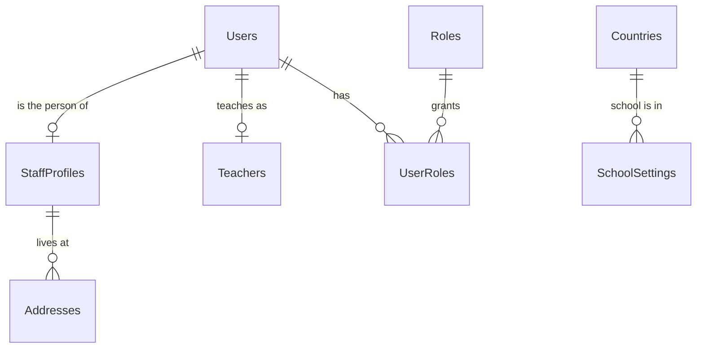

# E2 — Users, Staff Profiles & School Settings — Design

Status: **approved with changes 2026-10-14** (see "Decisions (approved 2026-10-14)" at the end; the
**DECISION** markers in the text refer to that list). Order: **E2s** (the three security fixes, own commit,
built first) → **E2a** (API) → **E3** (pages) → **E2c** (drop `Teachers.Name/Phone` after a count check).

## Purpose & scope

E2 is the backend for three things the prototype shows on *Users / Staff*, *My Account* and *Settings*:

1. **User accounts** managed by staff with the `Users.*` permissions: list, create, edit, change status,
   reset password, delete. Today the API can only *create* a user (`POST /api/users`), and teachers are the
   only staff with a profile.
2. **Staff profiles**: the person behind a staff login (full name, gender, mobile, joining date, ...). The
   prototype's user form has these fields for every staff member; today only `Teachers` holds a name and phone.
3. **School settings**: one record with the school's name, contact details, **time zone** (needed by F2 for
   "today"), currency and working days.

E3 builds the pages (Users / Staff list + detail + form, My Account, Settings, Roles & Permissions).
The change-password page already exists (U1), so admin password resets can ship in E2.

Out of scope (later): student and parent **logins** (the portal is not designed yet, F1 decision C), staff
documents, the prototype's teacher "Today's schedule" and "Teaching logbook" pop-ups (they need the
Timetable and Logbook modules), the Settings page's Theme and Maintenance tabs (theme is per user since U1;
"reset demo data" is prototype-only), and a logo upload.

## What exists today (and three problems found while reading it)

| Today | Where |
| --- | --- |
| `Users` (username, email, password hash, status Active/Inactive/Suspended, security stamp, lockout, MustChangePassword, soft delete) | D1/D2 |
| One role per user (service rule), roles editable on the Roles API | E1 |
| `Teachers` (UserId, **Name, Phone**, Specialization) + assignments; the Teachers page creates the login too | U2 |
| `POST /api/users` (create only), `POST /api/auth/unlock/{id}`, `POST /api/auth/change-password`, `GET /api/auth/me` | D1 |
| Permissions `Users.View/Create/Edit/Delete/ChangeStatus/ResetPassword`, `Settings.View/Edit` (Admin only) | E1 |

**Problem 1 — teacher account changes skip the security steps.** `TeacherService` changes a teacher's
status, deletes the login, or sets a new password *without* rotating the security stamp, revoking refresh
tokens or clearing the permission cache. The permission cache has no expiry, so a teacher who is
deactivated or deleted on the Teachers page keeps using the access token they already have (up to
15 minutes; the next refresh fails). A password set there also does not force a change at next login.
**Fix in E2:** every account change (status, password, role, delete) goes through one `UserAccountService`,
used by both the Users and the Teachers endpoints.

**Problem 2 — no "last active Admin" guard yet.** The rule was approved in E1 but there was no endpoint that
could break it. E2 adds the endpoints, so it adds the guard (with a lock, so two admins cannot deactivate each
other at the same moment).

**Problem 3 — password hashes reach the audit log.** `User.PasswordHash` and `User.SecurityStamp` carry no
`[AuditMasked]`, so every password change (and every role/status change that rotates the stamp) writes the
old and new hash and stamp into `AuditLogs` in plain text. A hash is not the password, but it can be attacked
offline and must not sit in a table many people may read later. `LastLoginAt` and `AccessFailedCount` also
create an audit row on every sign-in, which is noise. **Fix in E2s:** mask `PasswordHash` and `SecurityStamp`,
leave `LastLoginAt` and `AccessFailedCount` out of the log (`[AuditIgnore]`; `UpdatedAt` still moves).
`LockoutEnd` stays in the log on purpose: a lockout and an admin's unlock are security events. Migration
`E2s_MaskUserSecretsInAuditLog` overwrites the hash and stamp values already in `AuditLogs` with `***` (who
changed it and when stay).

## Entity list

| Entity | Purpose | Key | Notes |
| --- | --- | --- | --- |
| `Users` (changed) | Login account | Id | + `RowVersion` (edit conflicts → 409) |
| `StaffProfiles` (new) | The person behind a staff login | Id; `UserId` unique | 1:1 with Users; one per staff user, none for student/parent logins |
| `Teachers` (changed) | Teaching record: specialization, assignments | Id; `UserId` unique | `Name`/`Phone` move to `StaffProfiles` (expand/contract) |
| `Addresses` (changed) | + owner column `StaffProfileId` | | the G1 address rules apply to staff unchanged |
| `SchoolSettings` (new) | The school's own record | Id = 1 (CHECK) | exactly one row, seeded |

Relationships: User 1—0..1 StaffProfile; User 1—0..1 Teacher; StaffProfile 1—* Addresses; Country 1—*
SchoolSettings (the school's country, for the address forms' **suggested** country — see DECISION 6).

### Why a separate StaffProfiles table (and not more columns on Users)

`Users` is the security record: every request reads it (through the permission cache), and its columns are
about signing in. Profile data (name, date of birth, emergency contact) changes for other reasons, is
partly sensitive, and does not exist for student/parent logins. Keeping it in its own 1:1 table keeps the
login row small and lets the audit log mask the sensitive profile fields without touching the security
columns. This was agreed in the Batch E review; E2 only fills in the columns.

### Why Teachers keeps its own table

A teacher is a staff member **plus** teaching data (specialization, subject and class-teacher assignments,
later timetable and logbook). Moving that into `StaffProfiles` would put teaching columns on every clerk.
So: `StaffProfiles` = person, `Teachers` = teaching role. Both point at the same `UserId`; there is no FK
between them (agreed in the handoff). The teacher's name shown everywhere comes from the profile.

## Schema

### StaffProfiles

| Column | Type | Null | Key | Notes |
| --- | --- | --- | --- | --- |
| Id | int identity | N | PK | |
| UserId | int | N | FK → Users, UQ (filtered `IsDeleted = 0`) | 1:1 |
| FullName | nvarchar(150) | N | | CHECK not blank. Copied from `Teachers.Name`; other users get their username (DECISION 3) |
| Gender | nvarchar(10) | Y | | CHECK Male / Female (same list as students); prototype marks it required → required in the **form** for new staff, nullable for copied rows |
| DateOfBirth | date | Y | | |
| Mobile | nvarchar(20) | Y | | same phone rules as parents; required in the form for new staff, nullable for copied rows |
| JoiningDate | date | Y | | prototype: required on the form; copied rows take the user's `CreatedAt` date |
| Qualification | nvarchar(150) | Y | | e.g. "M.Sc Mathematics" |
| EmployeeNumber | nvarchar(30) | Y | UQ when present | **DECISION 4** (not in the prototype) |
| BloodGroup | nvarchar(10) | Y | | `[AuditMasked]` |
| EmergencyContactName | nvarchar(150) | Y | | `[AuditMasked]` |
| EmergencyContactPhone | nvarchar(20) | Y | | `[AuditMasked]` |
| CreatedAt / UpdatedAt / CreatedBy / UpdatedBy | | | | interceptor |
| IsDeleted / DeletedAt / DeletedBy | | | | deleted together with the user |
| RowVersion | rowversion | N | | |

Specialization stays on `Teachers` (it is teaching data). Addresses come from the `Addresses` table
(owner `StaffProfileId`), so the prototype's one-line address becomes the shared address editor.

### Users (changed)

Add `RowVersion` (binary(8), set by the application — see "E2a as built"). Nothing else changes; `LastLoginAt` already exists for the list's
"Last login" column.

### Teachers (changed, expand/contract)

E2 copies `Name` → `StaffProfiles.FullName` and `Phone` → `StaffProfiles.Mobile`, and from then on the API
reads and writes the profile. The old columns are **dropped in the same migration** (DECISION 2: the copy
is one-to-one and lossless, unlike the address copy, so a separate contract step adds nothing; Down
re-creates and refills them from the profile).

### Addresses (changed)

Add `StaffProfileId` (FK → StaffProfiles), extend `CK_Addresses_ExactlyOneOwner` to four owners, add
`UX_Addresses_Staff_Type` and `UX_Addresses_Staff_Primary` like the other owners. No data copy (staff have no
addresses today).

### SchoolSettings (one row)

| Column | Type | Null | Notes |
| --- | --- | --- | --- |
| Id | int | N | PK, CHECK `Id = 1` — there is exactly one school (locked decision 1) |
| SchoolName | nvarchar(150) | N | shown in the top bar and on printouts |
| ShortName | nvarchar(30) | Y | |
| Email / Phone / Website | nvarchar(100) / (20) / (200) | Y | |
| AddressText | nvarchar(300) | Y | the school's postal address as free text (a full `Addresses` owner would be overkill for one row) |
| CountryId | int | Y | FK → Countries. The school's country (DECISION 6) |
| TimeZoneId | nvarchar(64) | N | IANA id, e.g. `Asia/Dubai`; validated as a real time zone on save (DECISION 5 for the seed value) |
| CurrencyCode | nchar(3) | N | ISO 4217, e.g. `AED`, `INR`; CHECK three upper-case letters. Used by Fees later |
| WorkingDays | tinyint | N | bit mask Mon=1 … Sun=64, CHECK 1–127. Prototype: "drives attendance %, timetable defaults, holiday detection" |
| AboutTagline | nvarchar(300) | Y | prototype's About page text |
| UpdatedAt / UpdatedBy | | | |
| RowVersion | rowversion | N | two admins editing settings → 409 |

Why a single typed row and not a key/value table: every value has a type and a rule (time zone must exist,
currency is three letters, at least one working day). Columns give the database CHECKs and EF types for free;
a key/value table would turn every rule into code and every read into string parsing. A new setting is one
column in a migration, which is fine for a handful of school-wide values.

What stays in `appsettings.json` and why: values for the **people running the server** (document storage
folder, upload size limit, token lifetimes, retention) stay in configuration; values the **school** decides
(name, time zone, working days) live in this table and are edited on the Settings page.

The settings are read on almost every request once F2 lands ("today" in the school's time zone), so they are
cached in memory (`ISchoolSettingsProvider`, singleton) and the cache is cleared after a successful save.

Academic year dates are **not** duplicated here: they already live in `AcademicYears`. The prototype's
"Academic Year Start/End" fields on the Settings page become a link to the academic year (managing years is
its own small module, later).

## Business rules

Accounts:

- **Who is staff.** Every user that is not linked to a student or parent record is staff and has a
  `StaffProfile`. E2 creates staff accounts only; roles `Student` and `Parent` are refused on create until the
  portal exists (DECISION 1).
- **Create** (`Users.Create`): username, email, role, temporary password, profile fields. The account always
  starts with `MustChangePassword = true`, so the person sets their own password at first sign-in.
  Creating a user with the **Teacher** role also creates the `Teachers` row (so the Teachers page and
  assignments work at once). The Teachers page "New teacher" uses the same path.
- **Edit** (`Users.Edit`): username, email, profile, role. Changing the role rotates the security stamp and
  clears the permission cache (the user's next request uses the new role).
  - Changing *to* Teacher creates the `Teachers` row (or restores it); changing *away from* Teacher is refused
    while the teacher has subject or class-teacher assignments (same rule as deleting a teacher today).
- **Status** (`Users.ChangeStatus`): Active / Inactive / Suspended. Anything but Active blocks sign-in and ends
  every session (stamp rotated, refresh tokens revoked, cache cleared). Inactive = left the school;
  Suspended = temporarily blocked. **Unlock** (clear a lockout) stays on the same permission.
- **Reset password** (`Users.ResetPassword`): the admin types a temporary password (shown once on screen,
  never logged); `MustChangePassword = true`; all sessions end. (No e-mail is sent: the system has no mail
  server yet.)
- **Delete** (`Users.Delete`): soft delete of the user, its profile and its teacher row; all sessions end. The
  username and e-mail become free again (locked decision 7). Refused when the user is **you**, the **last
  active Admin**, or a teacher **with assignments**.
- **Guards that apply to every change above**: you cannot change your own role, status or delete yourself
  (use My Account for your own profile and password); the last active Admin cannot be demoted, deactivated,
  suspended or deleted (checked under a lock so two admins cannot remove each other at the same moment);
  you cannot give a role whose permissions you do not hold (E1 rule, reused).
- **One code path**: Users and Teachers endpoints both call `UserAccountService` for status, password, role
  and delete (fixes Problem 1). The Teachers edit form keeps name/phone/specialization; its username, e-mail,
  status and password fields move to the user endpoints (DECISION 7).

My Account (any signed-in staff user, no extra permission): read and edit **your own** profile (full name,
mobile, date of birth, qualification, emergency contact, blood group, addresses) and e-mail; not username,
role, status or joining date. Password change already exists.

Settings: `Settings.View` reads, `Settings.Edit` saves (with rowVersion). The school name is also returned by
`GET /api/auth/me` so the top bar can show it for everyone.

## API

| Method | Path | Permission | Notes |
| --- | --- | --- | --- |
| GET | /api/users | Users.View | list: id, username, fullName, email, mobile, role, gender, status, joiningDate, lastLoginAt, isLocked, mustChangePassword, teacherId |
| GET | /api/users/{id} | Users.View | + full profile, addresses, rowVersion |
| POST | /api/users | Users.Create | (exists — extended with the profile; MustChangePassword = true) |
| PUT | /api/users/{id} | Users.Edit | username, email, role, profile, addresses (null = keep), rowVersion |
| PATCH | /api/users/{id}/status | Users.ChangeStatus | Active / Inactive / Suspended, rowVersion |
| POST | /api/users/{id}/reset-password | Users.ResetPassword | temporary password |
| POST | /api/users/{id}/unlock | Users.ChangeStatus | moved from /api/auth/unlock/{id} (old route kept until E3, then removed) |
| DELETE | /api/users/{id} | Users.Delete | soft |
| GET | /api/me/profile | signed in | own profile |
| PUT | /api/me/profile | signed in | own profile + e-mail, rowVersion |
| GET | /api/settings/school | Settings.View | |
| PUT | /api/settings/school | Settings.Edit | rowVersion |
| GET | /api/settings/time-zones | Settings.View | the list for the time-zone picker |

Errors follow the existing envelope: 400 field errors, 404, 409 (duplicate username/e-mail, stale
rowVersion, guards), 422 for "last active Admin" and "own account" (business rules).

## Audit

- `StaffProfiles`: normal audit; `BloodGroup`, `EmergencyContactName`, `EmergencyContactPhone` masked.
  Addresses already masked (G1a).
- `Users`: audited; from E2 `PasswordHash` and `SecurityStamp` are masked and the sign-in counters are left
  out (Problem 3). A password reset shows up as an Update with `PasswordHash: ***`,
  `MustChangePassword: false → true` and the admin's id.
- `UserRoles`: audited (insert/delete rows show who changed whose role).
- `SchoolSettings`: normal audit.

## Index strategy

| Index | Why |
| --- | --- |
| UX_StaffProfiles_UserId (filtered IsDeleted = 0) | 1:1 and the join from Users |
| UX_StaffProfiles_EmployeeNumber (filtered NOT NULL AND IsDeleted = 0) | only if DECISION 4 = yes |
| UX_Addresses_Staff_Type / _Primary | G1 address rules for the new owner |
| Users list | no new index: the list loads all staff (tens to low hundreds of rows) like the other lists |

## Migration plan (one migration, hand-checked)

1. `Users.RowVersion`; `StaffProfiles`; `SchoolSettings` + seed row (DECISION 5); `Addresses.StaffProfileId` +
   CHECK + indexes.
2. Copy: one profile per non-deleted user that is not linked from `Students.UserId` / `Parents.UserId`.
   FullName = the teacher's name if the user is a teacher, else the username; Mobile = the teacher's phone;
   JoiningDate = the user's `CreatedAt` date.
3. Guard (like G1c): stop if any teacher has no profile after the copy.
4. Drop `Teachers.Name` and `Teachers.Phone` (DECISION 2). Down re-creates and refills them from the profiles.
5. Scrub `AuditLogs`: set the `PasswordHash` and `SecurityStamp` values already logged for `Users` to `***`
   (Problem 3). This cannot be undone, by design.

Back up first with `g1a-backup-before-migration.sql` (`@label = 'E2'`).

## Tests

- Database rules: one profile per user; SchoolSettings has exactly one row (a second insert fails); time-zone,
  currency and working-day CHECKs; staff address owner rules.
- Account rules (API): create → MustChangePassword; role change ends the session (old token → 401);
  deactivate/suspend/delete end the session; reset password forces a change; cannot change own role/status
  or delete self; last active Admin cannot be demoted/deactivated/deleted, including two admins trying at
  once; leaving the Teacher role / deleting a teacher with assignments is refused; Teacher role creates the
  Teachers row.
- **Problem 1 regression**: deactivating a teacher on the Teachers endpoint ends their session immediately.
- **Problem 3 regression**: after a password change the new `AuditLogs` row shows `***` for the hash and stamp,
  and a sign-in writes no audit row.
- My Account: edits only your own profile; cannot change role/status/username.
- Settings: invalid time zone → 400; stale rowVersion → 409; the cache serves the new values right after save.
- Access matrix rows for every new endpoint.

## DECISIONS needed

1. **Student and parent logins**: refuse the Student and Parent roles on the Users API until the portal is
   designed (recommended), or allow creating them now (unlinked accounts that can see nothing)?
2. **Teachers.Name/Phone**: copy and drop in the same E2 migration (recommended: lossless, Down refills them),
   or keep them until a separate contract step like G1c?
3. **Full name for existing users without a teacher record** (e.g. `admin`): use the username until someone
   edits it (recommended), or require it to be filled before E2 can run?
4. **Employee number**: not in the prototype. Add an optional, unique `EmployeeNumber` now, or leave it out?
5. **Seed values for SchoolSettings**: school name, time zone and currency to start with. Proposal:
   name "Eschool" (edit on the Settings page), time zone `Asia/Dubai`, currency `AED`, working days
   Mon–Fri. Please give the real values or confirm.
6. **School country**: store it (recommended: optional, lets address forms *suggest* it without making it a
   default the user did not choose), or leave it out to keep "no default country" strict?
7. **Teachers page**: move username / e-mail / status / password out of the teacher form to the Users page
   (recommended: one place for account security), or keep them on the teacher form (calling the same
   account service)?
8. **Order**: E2 (API) then E3 (pages) as planned, or build them together per screen (Users list + form +
   detail, then My Account, then Settings)?

## Decisions (approved 2026-10-14)

1. **Student and Parent roles are refused** on the Users API (and by the account service) until the portal is designed.
2. **Two steps for Teachers.Name/Phone:** E2a copies them to the profile and the API reads the profile; a later
   **E2c** drops the old columns after a count check (like G1c). The "Migration plan" step 4 moves to E2c.
3. **Users without a name** get their username as full name and are flagged **"needs name"** in the Users list
   (a `NeedsName` flag in the response: true while FullName still equals the username from the copy).
4. **Employee number:** optional, unique when present (filtered unique index).
5. **School settings seed:** placeholders until the real time zone and currency are given (name "School",
   time zone `Asia/Dubai`, currency `AED`, Mon–Fri); one UPDATE fixes them.
6. **School country:** stored; used only to **pre-select** the country in address forms (still changeable, never assumed on save).
7. **Teachers page:** username, e-mail, status and password move to the Users page; the teacher form keeps name, phone and specialization.
8. **Order:** API first. The three security fixes ship as their **own commit first (E2s)** with tests for:
   demote / deactivate / delete of the last admin, two admins at once, a deactivated teacher refused immediately,
   hashes masked on every audit path. Back up before the audit rewrite. E2a adds a Swagger / `.http` test file
   for the new endpoints.

### E2s as built

- `IUserAccountService` / `UserAccountService` (Application): status, temporary password, role, delete. One
  `sp_getapplock` ("UserAccountChanges") per change, so the last-admin check is safe when two admins act at once;
  refuses your own account; refuses Student/Parent (decision 1) and, until E2a, moving into or out of Teacher;
  rotates the stamp, saves, then clears the cache and revokes refresh tokens.
- `TeacherService`: status, delete and admin-set password go through it; a teacher created on the Teachers page
  must change the password at first sign-in.
- `User`: `[AuditMasked]` PasswordHash and SecurityStamp, `[AuditIgnore]` LastLoginAt and AccessFailedCount.
- Tests: `DatabaseRules/UserAccountRulesTests`, `IntegrationTests/AccountSecurityTests`, a scrub test in `AuditTrailTests`.

### E2a as built

**Schema (migration `20261014075122_E2a_StaffProfilesAndSchoolSettings`, hand-edited):**
`StaffProfiles` (one per user, filtered unique `UserId`; optional `EmployeeNumber`, unique when present;
blood group and emergency contact masked in the audit log), `SchoolSettings` (one row, `CHECK Id = 1`, seeded
with the placeholders of decision 5), `Addresses.StaffProfileId` (fourth owner in the one-owner CHECK),
`Users.RowVersion`. The copy (decision 2/3) and its guard run at the end of Up; Down deletes staff addresses first.

**One change from the design: `Users.RowVersion` is `binary(8)` set by the application, not a SQL `rowversion`.**
Signing in writes `LastLoginAt` (and failed attempts write `AccessFailedCount`) to the same row. With a SQL
rowversion, every sign-in would change the version, so an administrator who opened a user's edit form and
saved after that user signed in would get a 409 "someone else saved" although nobody edited anything. Now the
version changes only when the account or its profile is edited: every such save calls `User.NewVersion()`
(UserService edit and My Account, the account service for status/role/password/delete, the Teachers edit form).
Existing users get a random starting value in the migration.

**API** (as in the table above, plus):
- `GET /api/settings/basics` — any signed-in user: school name, short name, country id (top bar; address
  forms pre-select the country, decision 6). Served from `ISchoolSettingsProvider`, a singleton cache cleared
  after each settings save (single server, like the permission cache).
- `POST /api/auth/unlock/{id}` still exists next to `POST /api/users/{id}/unlock`; it goes in E3.
- Teacher accounts: role **Teacher** on the Users page creates the Teachers row (name and phone from the
  profile, specialization from the request). Moving a teacher to another role, or deleting the account, is
  refused (422) while the teacher still teaches a subject or is a class teacher; otherwise the Teachers row is
  soft-deleted with it. Until E2c, `Teachers.Name/Phone` are written together with the profile's
  `FullName/Mobile` (Users edit, My Account and the Teachers page all keep them in step).
- A role change in the edit form runs inside the same transaction as the profile and addresses, with the same
  guards as the account service (not your own account, never the last active Admin, only roles whose
  permissions you hold, no Student/Parent).
- The Users form requires full name, gender, mobile and joining date; rows copied by the migration may lack
  them until someone edits the user. My Account cannot change username, role, status, joining date or
  employee number.
- Time zones are stored and listed as **IANA ids** ("Asia/Dubai"); a Windows id is refused so the value does
  not depend on the server's operating system.

**Tests:** `DatabaseRules/StaffProfileRulesTests` (one profile per user, employee number, gender/name checks,
staff address owner, one settings row and its checks, the migration's copy and guard),
`IntegrationTests/UsersApiTests` (create, teacher record, Student/Parent refused, duplicates, edit + 409,
role change ends sessions, teacher with assignments, status/password/unlock/delete, needs-name flag,
My Account, settings and time zones), validator and UserService unit tests, and the new rows in
`AccessMatrixTests`. Manual: `backend/SchoolManagement.API/E2-Users-Settings.http`.
