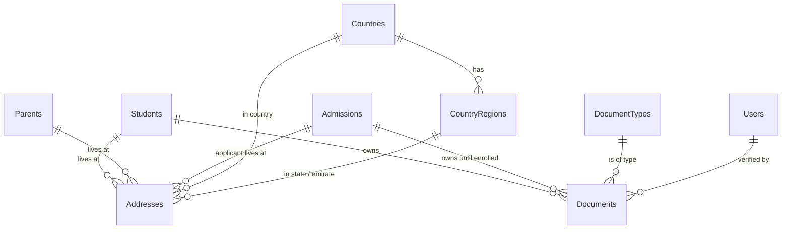

# G1 — Addresses & Documents — Database Design

Status: **approved with changes 2026-10-13** (decisions recorded in the last sections). G1a (Addresses) and G1b (Documents) are built; G1c (drop the old address columns) follows. The G1a copy check passed on 2026-10-13 (2 applications and 1 student copied, nothing left over), so G1c is unblocked.

## Purpose & scope

Two things that every "person" module needs and that today are either copied around or missing:

1. **Addresses.** `Students`, `Parents` and `Admissions` each carry the same four columns (`AddressLine`, `City`, `State`, `Pincode`), only one address per person, India-shaped (Pincode) although the school is in the UAE. Staff (E2) would add a fourth copy.
2. **Documents.** The prototype has a Documents page (types, owner, file, Pending/Verified, uploaded by, verified by) but the system stores no files at all.

Already decided (handoff, 2026-10-12): one `Addresses` table with real owner foreign keys; documents up to 5 MB (a setting since G1b), PDF/JPG/PNG checked by content, office staff only, no self-verify, files outside the web root behind `IFileStorage`, download through an authorized endpoint with a Read audit row, permissions `Documents.View/Upload/Verify/Delete`, identity documents also need `Students.ViewSensitive`, applicant documents move to the student on enrolment, files picked on a New form are uploaded after the record is saved (no server temp area).

Out of scope: staff addresses/documents (the `StaffProfiles` table arrives in E2 and gets its owner column then), parent portal uploads, document templates/generation (bonafide certificates etc.).

## Entity list

| Entity | Purpose | PK | Key FKs |
| --- | --- | --- | --- |
| `Addresses` | Up to three typed addresses (Home, Permanent, Mailing) for one owner | Id | StudentId / ParentId / AdmissionId (exactly one), CountryId, (CountryId, RegionId) |
| `Countries` | Setting: the countries offered in address forms, with their postcode rule | Id | — |
| `CountryRegions` | Setting: the states / emirates of each country | Id | CountryId |
| `DocumentTypes` | Lookup: the kinds of document and their rules (sensitive? has expiry? who can own it?) | Id | — |
| `Documents` | One uploaded file: metadata, verification state, where the bytes are stored | Id | StudentId / AdmissionId (exactly one), DocumentTypeId, VerifiedBy → Users |

Relationships: Student 1—* Addresses, Parent 1—* Addresses, Admission 1—* Addresses; Country 1—* CountryRegions; Country 1—* Addresses; CountryRegion 1—* Addresses; Student 1—* Documents, Admission 1—* Documents; DocumentType 1—* Documents; User 1—* Documents (verified by). No many-to-many.

## Why "one column per owner" and not OwnerType + OwnerId

The common shortcut is two columns, `OwnerType = 'Student'` and `OwnerId = 42`. It is one table and looks flexible, but SQL Server cannot put a foreign key on it: a row can point at a student that was never there, deleting an owner cannot cascade, and every query needs `WHERE OwnerType = …`. With one nullable FK column per owner (`StudentId`, `ParentId`, `AdmissionId`) the database checks every link, indexes are simple, and a CHECK constraint guarantees **exactly one** owner per row. The cost is one extra column per future owner (E2 adds `StaffProfileId`), which is a small, explicit migration.

## Schema

### Addresses

| Column | Type | Null | Key | Default | Notes |
| --- | --- | --- | --- | --- | --- |
| Id | int identity | N | PK | | |
| StudentId | int | Y | FK→Students | | exactly one of the three owner columns is set |
| ParentId | int | Y | FK→Parents | | |
| AdmissionId | int | Y | FK→Admissions | | the applicant's address |
| AddressType | nvarchar(20) | N | | | Home / Permanent / Mailing; at most one of each per owner |
| IsPrimary | bit | N | | 0 | exactly one per owner that has addresses |
| Line1 | nvarchar(200) | N | | | villa/flat, building, street (CHECK: not blank) |
| Line2 | nvarchar(200) | Y | | | area / landmark |
| City | nvarchar(60) | N | | | (CHECK: not blank) |
| CountryId | int | N | FK→Countries | | **no default**: chosen in the form |
| RegionId | int | Y | FK (CountryId, RegionId)→CountryRegions (CountryId, Id) | | emirate / state; required by the service when the country has regions; NULL only for copied legacy rows whose state was not recognised |
| PostalCode | nvarchar(12) | Y | | | required + format per country (India: 6 digits, not starting with 0; UAE: optional) |
| CreatedAt / UpdatedAt | datetime2 | N | | | UTC, set by the audit interceptor |
| CreatedBy / UpdatedBy | int | Y | | | |

Constraints

- `CK_Addresses_ExactlyOneOwner`: `(CASE WHEN StudentId IS NULL THEN 0 ELSE 1 END) + … = 1`: no owner and two owners are both rejected.
- `CK_Addresses_AddressType`: AddressType IN ('Home','Permanent','Mailing'); `CK_Addresses_Line1NotBlank`, `CK_Addresses_CityNotBlank`.
- At most one address per type per owner: `UX_Addresses_Student_Type (StudentId, AddressType) WHERE StudentId IS NOT NULL`, same for Parent and Admission.
- At most one primary per owner: `UX_Addresses_Student_Primary (StudentId) WHERE StudentId IS NOT NULL AND IsPrimary = 1`, same for the others.
- The region belongs to the country: composite FK `FK_Addresses_CountryRegions_CountryId_RegionId` to the alternate key `AK_CountryRegions_CountryId_Id`.
- "At least one primary when an owner has addresses" spans rows, so it cannot be a CHECK: the request validator requires exactly one primary in a non-empty list, and the indexes stop a second one.
- Country-dependent rules (region required, postcode required / format) need the Countries table, so the service checks them (`AddressService.BuildAsync`) and answers 400 with field errors such as `Addresses[0].PostalCode`.

No `RowVersion`, no soft delete. Addresses are edited **with their owner** (the student/parent/application form sends the whole list; `null` keeps the stored list). The service matches rows **by type**, so an edited Home address keeps its row id and its audit history; it saves in two steps inside the owner's transaction (first removals and the old primary flag, then updates and inserts) so the unique indexes never see old and new rows together; so the owner's rowversion already protects them from two people saving at once, and the audit log keeps the old values. Deleting an owner: owners are soft-deleted, so their addresses simply stay with them; FK delete rule is CASCADE (only reached by hard deletes in tests). If SQL Server reports "multiple cascade paths" (Admission → Student), that FK falls back to NO ACTION.

### Countries and CountryRegions (settings, seeded)

| Column | Type | Null | Key | Notes |
| --- | --- | --- | --- | --- |
| Countries.Id | int identity | N | PK | |
| Countries.Code | nchar(2) | N | UQ | ISO 3166-1 alpha-2 (`IN`, `AE`), CHECK upper case |
| Countries.Name | nvarchar(60) | N | UQ | |
| Countries.RegionLabel | nvarchar(30) | N | | what the form calls the region: "State", "Emirate" |
| Countries.PostalCodeRequired | bit | N | | India 1, UAE 0 |
| Countries.PostalCodePattern | nvarchar(100) | Y | | regular expression; India `^[1-9][0-9]{5}$` |
| Countries.PostalCodeHint | nvarchar(60) | Y | | shown in the error: "6 digits, e.g. 600001" |
| Countries.SortOrder, IsActive | int, bit | N | | inactive countries are hidden in forms |
| CountryRegions.Id | int identity | N | PK | |
| CountryRegions.CountryId | int | N | FK→Countries | |
| CountryRegions.Name | nvarchar(60) | N | UQ (CountryId, Name) | |
| CountryRegions.SortOrder, IsActive | int, bit | N | | |

Why tables and not a code list: the school is not tied to one country, and adding a country (with its regions and postcode rule) must not need a release. Seeded by the migration: India (28 states + 8 union territories) and the United Arab Emirates (7 emirates). Until the Settings page exists (E2), a country is added with an `INSERT` into both tables. `GET /api/countries` serves them to every signed-in user.

### DocumentTypes (lookup table)

| Column | Type | Null | Key | Default | Notes |
| --- | --- | --- | --- | --- | --- |
| Id | int identity | N | PK | | |
| Code | nvarchar(40) | N | UQ | | stable key used by code and seed, e.g. `BirthCertificate` |
| Name | nvarchar(80) | N | | | shown in the UI |
| IsSensitive | bit | N | | 0 | identity documents: download also needs Students.ViewSensitive |
| HasExpiry | bit | N | | 0 | passport, visa, Emirates ID: ExpiryDate required |
| ForStudents | bit | N | | 1 | can be attached to students and applicants |
| ForStaff | bit | N | | 0 | used from E2 |
| SortOrder | int | N | | 0 | |
| IsActive | bit | N | | 1 | retired types stay for old documents but are not offered |

Why a table and not an enum or a string list: each type carries **rules** (sensitive, expiry, which owners) that the API must check on every upload and download, and the school will want to add types (e.g. "Vaccination record") without a release. Seeded by migration with name-keyed SQL, like permissions. Approved seed (decision 3):

| Code | Name | Sensitive | Expiry |
| --- | --- | --- | --- |
| BirthCertificate | Birth certificate | yes | no |
| Passport | Passport | yes | yes |
| ResidenceVisa | Residence visa | yes | yes |
| EmiratesId | Emirates ID | yes | yes |
| Aadhaar | Aadhaar | yes | no |
| Photo | Photograph | no | no |
| TransferCertificate | Transfer certificate | no | no |
| ReportCard | Previous report card / marksheet | no | no |
| MedicalRecord | Medical / vaccination record | yes | no |
| Other | Other | no | no |

### Documents

| Column | Type | Null | Key | Default | Notes |
| --- | --- | --- | --- | --- | --- |
| Id | int identity | N | PK | | |
| StudentId | int | Y | FK→Students | | exactly one owner |
| AdmissionId | int | Y | FK→Admissions | | set while the applicant is not yet a student |
| DocumentTypeId | int | N | FK→DocumentTypes | | |
| Title | nvarchar(120) | Y | | | optional label, e.g. "Passport (old)" |
| OriginalFileName | nvarchar(255) | N | | | shown and used as the download name; never used as a path |
| ContentType | nvarchar(50) | N | | | from the file's own bytes, not the browser: application/pdf, image/jpeg, image/png |
| SizeBytes | int | N | | | CHECK > 0; the LIMIT is the setting `Documents:MaxFileSizeBytes` (default 5 242 880), checked by the API |
| Sha256 | binary(32) | N | | | integrity check on download; the same file once per owner (unique index, below) |
| StorageKey | nvarchar(200) | N | UQ | | where `IFileStorage` keeps the bytes, e.g. `2026/10/7f3c…e1.pdf` (random, never the user's file name) |
| ExpiryDate | date | Y | | | required when the type HasExpiry (checked by the service) |
| Status | nvarchar(20) | N | | 'Pending' | Pending / Verified / Rejected; Unverify returns to Pending (decision 5) |
| VerifiedBy | int | Y | FK→Users | | who verified or rejected |
| VerifiedAt | datetime2 | Y | | | UTC |
| RejectionReason | nvarchar(300) | Y | | | |
| CreatedAt / CreatedBy | | | | | CreatedBy = "uploaded by" |
| UpdatedAt / UpdatedBy | | | | | |
| IsDeleted / DeletedAt / DeletedBy | | | | | soft delete |
| FilePurgedAt | datetime2 | Y | | | G1b: when the purge job removed the file of a deleted document; the row stays as the record |
| RowVersion | rowversion | N | | | two people verifying/deleting at once → 409 |

Constraints

- `CK_Documents_ExactlyOneOwner` (as for Addresses).
- `CK_Documents_Status`: IN ('Pending','Verified','Rejected').
- `CK_Documents_SizePositive`: SizeBytes > 0. (Changed in G1b: the limit is a setting, so the number is not in the database; a CHECK with it would need a migration for every change of the setting.)
- `CK_Documents_ContentType`: IN ('application/pdf','image/jpeg','image/png').
- `CK_Documents_ReviewedHasReviewer`: Status = 'Pending' OR (VerifiedBy IS NOT NULL AND VerifiedAt IS NOT NULL).
- `CK_Documents_RejectedHasReason`: Status <> 'Rejected' OR the reason is not blank.
- `CK_Documents_PendingHasNoReviewer` (G1b): a Pending document has no reviewer, review date or reason, so Unverify must clear them.
- `UX_Documents_Student_Sha256` / `UX_Documents_Admission_Sha256` (G1b): (owner, Sha256) unique where the document is not deleted. A repeated upload of the same file (double click, retry, the same scan picked twice) is refused with 409 instead of creating a second document; a deleted copy does not count, so a file deleted by mistake can be uploaded again. The same file for two different students (siblings) is allowed.
- `CK_Documents_NoSelfVerify`: VerifiedBy IS NULL OR CreatedBy IS NULL OR VerifiedBy <> CreatedBy. (The service checks it first with a clear message; the constraint is the safety net, same pattern as the admission CHECKs.)

Why the file bytes are **not** in the database: a `varbinary(max)` column would make every backup, restore and index rebuild carry every scan the school ever uploaded, and EF would load whole files into memory on ordinary queries. The table keeps the metadata; `IFileStorage` keeps the bytes. Development uses a folder outside the web root (path from configuration); production can switch to Azure Blob/S3 by adding another `IFileStorage` implementation, with no schema change. `Sha256` lets the download endpoint detect a file changed or corrupted on disk.

## Index strategy

| Index | Columns | Why / which query |
| --- | --- | --- |
| UX_Addresses_{Student,Parent,Admission}_Type | owner, AddressType (filtered owner NOT NULL) | the one-per-type rule; also serves "load this owner's addresses", so no separate owner index |
| UX_Addresses_{owner}_Primary | owner WHERE IsPrimary = 1 | the one-primary rule; "primary address" lookups for lists/exports |
| IX_Addresses_CountryId_RegionId | CountryId, RegionId | the composite FK |
| UX_Countries_Code / UX_Countries_Name | | seed and lookups by code |
| UX_CountryRegions_Country_Name | CountryId, Name | one name per country; seed is name-keyed |
| UX_DocumentTypes_Code | Code | seed and code look types up by code |
| IX_Documents_StudentId | StudentId INCLUDE (DocumentTypeId, Status) WHERE IsDeleted=0 | the student's Documents tab |
| IX_Documents_AdmissionId | AdmissionId WHERE IsDeleted=0 | the application's Documents tab; the enrolment move |
| IX_Documents_Status_CreatedAt | Status, CreatedAt WHERE IsDeleted=0 | Documents page: "Pending" queue, newest first (the prototype's pipeline) |
| IX_Documents_ExpiryDate | ExpiryDate WHERE ExpiryDate IS NOT NULL AND IsDeleted=0 | "expiring in the next 60 days" list |
| UX_Documents_StorageKey | StorageKey | one row per stored file |
| UX_Documents_{Student,Admission}_Sha256 | owner, Sha256 WHERE owner NOT NULL AND IsDeleted=0 | the "same file once per owner" rule; also serves the duplicate check before storing |
| IX_Documents_PurgeQueue | DeletedAt WHERE IsDeleted=1 AND FilePurgedAt IS NULL | the daily purge job |

## Audit strategy

- Both tables get the standard columns, stamped by the existing interceptor; every insert/update/delete is in `AuditLogs` like other tables.
- `Addresses`: Line1, Line2, City and PostalCode are `[AuditMasked]`. The audit row still shows who changed which owner's which address type (AddressType, IsPrimary, CountryId, RegionId) and when, never the address text (decision 4).
- `Documents`: metadata is audited normally (the file content is never in the log). Every **download** writes a `Read` row through `ISensitiveReadLog` (table `Documents`, the document id, and "File" / "File (sensitive)").
- `Sha256` and `StorageKey` are `[AuditIgnore]` (noise in the log, and the storage key is an internal path).

## Enums vs lookup tables

| Value | Choice | Why |
| --- | --- | --- |
| Address type | string + CHECK | small fixed list, no per-value rules |
| Country / region | **tables (settings)** | per-country rules (postcode), list grows without a release |
| Document type | **lookup table** | per-type rules, school will add types |
| Document status | string + CHECK | workflow states the code depends on |
| Content type | string + CHECK | fixed by the security rule (PDF/JPG/PNG) |

## Normalization review

- Today the address is a repeating group spread over three tables (and soon a fourth) with no way to hold a second address; `Addresses` removes the duplication and the one-address limit.
- **Applicant vs student addresses on enrolment: copied, not moved.** The application stays the historical record of what was submitted (the same "snapshot" rule we chose for guardians in the Parents design); the student gets its own copy that later edits change. Documents, by contrast, **move** (already decided): there is one physical file and it belongs to the student once enrolled; the application's Documents tab then says "moved to the student record".
- Parent and student addresses stay separate rows even when the family lives together: linking a child's address to a parent's would make one family's move silently change another child's record in a shared-custody case.

## Migration plan (expand / contract)

1. **G1a — Addresses (expand).** Back up first (`database/scripts/g1a-backup-before-migration.sql`). Create `Countries`, `CountryRegions` (seeded) and `Addresses`; copy each old address as `AddressType='Home', IsPrimary=1`. Since there is no default country, the country is **recognised, never assumed**: from the state/emirate name, else a valid 6-digit PIN (India), else a city that is an emirate (UAE). Rows without an address line, a city or a recognisable country are not copied; their old text is returned by the API as `legacyAddress` and shown on the edit form so staff can enter it properly. `database/scripts/g1a-address-copy-check.sql` gives the counts (had an address / copied / not copied) and the list, to run before G1c. From G1a on the API reads and writes only `Addresses`; the old columns stay untouched.
2. **G1b — Documents.** Create `DocumentTypes` (seeded) and `Documents`; `IFileStorage` + local implementation; permissions `Documents.View/Upload/Verify/Delete` added to the catalog (Admin gets them automatically; other roles via the Roles API).
3. **G1c — contract.** After you confirm the copied addresses look right, a separate migration drops `AddressLine/City/State/Pincode` from `Students`, `Parents`, `Admissions`.

Both G1a and G1b migrations are hand-checked (data copy SQL, seed SQL, CHECKs written by name), like E1/F1.

## API shape (for orientation; built after approval)

- Addresses: no endpoints of their own. Student / parent / admission requests gain `addresses: [{ addressType, isPrimary, line1, line2, city, countryId, regionId, postalCode }]` (null = keep); responses gain `addresses` (with country and region names) and `legacyAddress`. `GET /api/countries` returns the countries with regions and postcode rules.
- Documents (as built in G1b): `GET /api/documents/options` (types + size limit for the upload form), `GET /api/students/{id}/documents`, `GET /api/admissions/{id}/documents`, `POST` the same URLs (multipart, one file per request), `GET /api/documents?status=&documentTypeId=&expiry=Expired|ExpiringSoon` (Documents page; not paged yet, like the other lists, see "Open points"), `GET /api/documents/{id}/file` (download), `POST /api/documents/{id}/verify`, `POST /api/documents/{id}/reject`, `POST /api/documents/{id}/unverify`, `DELETE /api/documents/{id}`.

## Decisions (approved 2026-10-13)

1. **Address types:** Home, Permanent and Mailing; at most one of each per owner; one primary. Both rules are enforced by the database (filtered unique indexes), not only the form.
2. **Country and postcode:** the school is not fixed to one country. Country is a list (India, United Arab Emirates) kept as a setting (`Countries` / `CountryRegions` tables) so a country can be added without a release. **No default country.** "Emirate / State" lists the emirates for the UAE and the states for India. Postcode: required with a 6-digit check for India, optional for the UAE.
3. **Document types:** the list above is approved; Aadhaar, Emirates ID and Residence visa all stay (students may come from either country). No identity document is required for every student. Only types "with expiry" show an expiry date, and the Documents list can flag documents that are expired or expiring soon.
4. **Audit log:** address text is hidden. The log records who changed which address type and when.
5. **Document status:** Pending, Verified, Rejected, and Unverify (back to Pending). Rejected requires a reason. Unverify needs `Documents.Verify` and writes its own audit row. A rejected file is replaced by a **new upload**, never edited.
6. **Deleting documents:** a verified document must be unverified first; delete is soft and keeps the file. Retention of deleted files is a setting, default **90 days**; G1b adds a purge job that removes the file after that.
7. **Required documents before enrolment:** later, as proposed.
8. **Parents' documents:** not in G1.

## G1b decisions (2026-10-13)

1. **Size limit is a setting:** `Documents:MaxFileSizeBytes` (default 5 MB), not a constant. Both the browser and the API show the file's exact size and the limit, e.g. "The file is 5 MB (5,242,881 bytes). The largest file allowed is 5 MB (5,242,880 bytes)." A request whose total size is clearly over the limit is refused before it is read (413, with the upload size and the limit).
2. **File type from the content:** PDF / JPG / PNG are recognised by their first bytes (`%PDF-`, `FF D8 FF`, `89 PNG`), never by the extension or the browser's Content-Type. A program renamed to `.pdf` is refused; a real PNG named `scan.pdf` is accepted as a PNG and downloads as `scan.png`. The browser runs the same check first for an instant answer.
3. **Repeated upload:** the same file is attached to the same student or application once (409, unique index above).
4. **No self-review:** the uploader cannot verify or reject their own upload (422 from the service, `CK_Documents_NoSelfVerify` in the database).
5. **Unverify before delete:** deleting a verified document answers 409 "Unverify it first". Unverify applies to Verified only; a Rejected document is not reopened (it is replaced by a new upload, decision 5).
6. **Grants:** the four Documents permissions are in the catalog; no seeded role gets them (Admin holds them in code). Office roles get them on the Roles page.

## Open points

- **Deleting an application does not touch its documents.** The application is soft-deleted and its documents simply disappear with it (they are hidden, not deleted), so their files are never purged. BUSINESS DECISION REQUIRED: should deleting an application also soft-delete its documents, so the retention period and the purge apply to them?
- **Paging:** `GET /api/documents` returns every matching document (metadata only), like the other lists. Server paging comes with the DataTable "server mode" for all lists together.

## Operations notes

- **G1a:** back up the database before applying the migration (script above); keep the old address columns until G1c; run the copy check before G1c.
- **G1b:** from G1b on, a backup is the database **and** the uploaded-files folder (`Documents:StorageRoot`), taken together; one without the other cannot be restored to a consistent state. Written up in `docs/deployment.md` (routine, settings, folder permissions).
